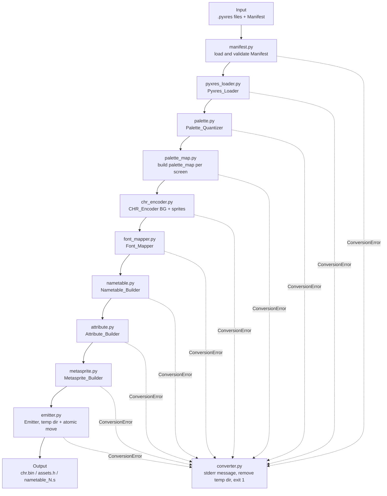
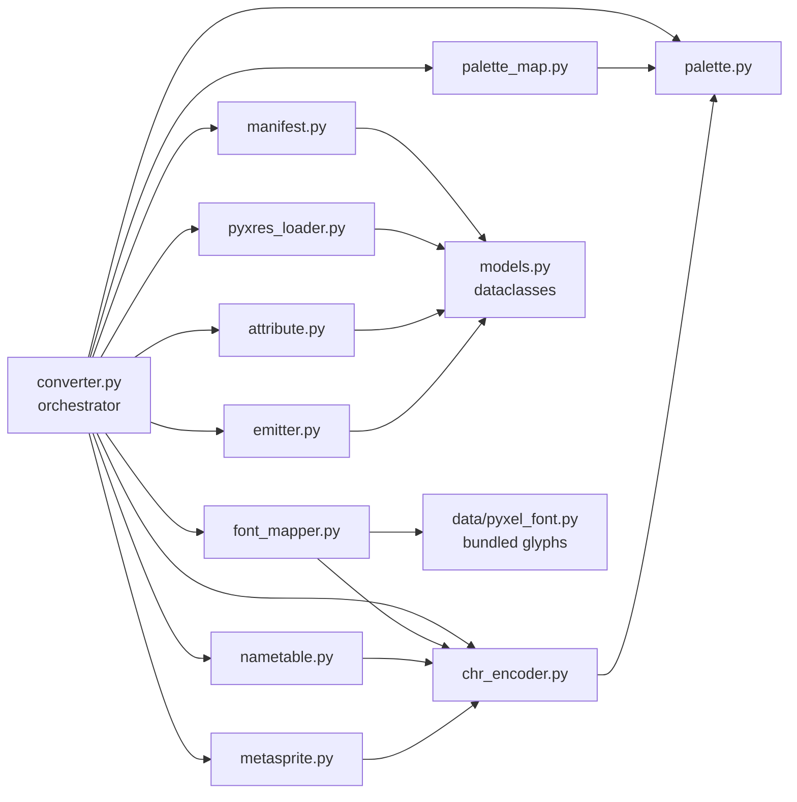
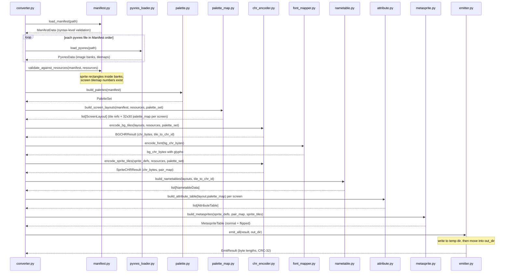
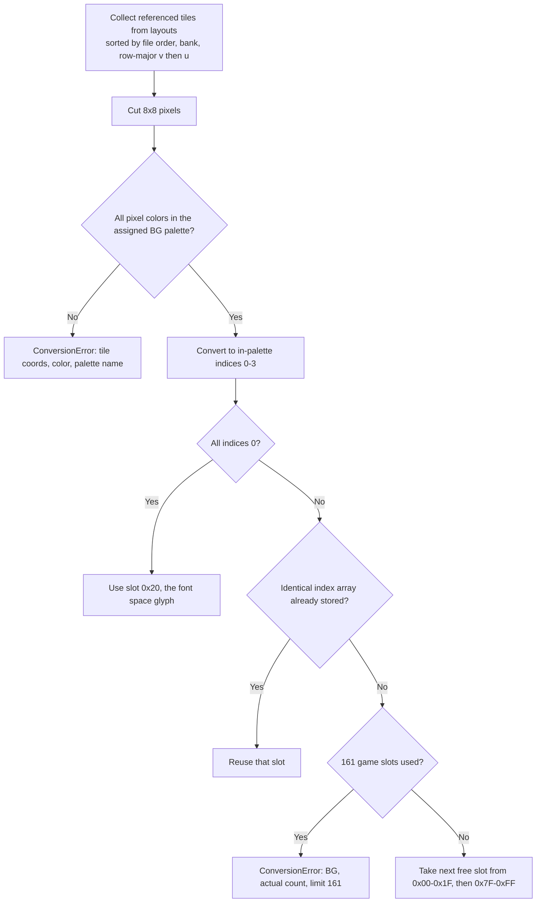
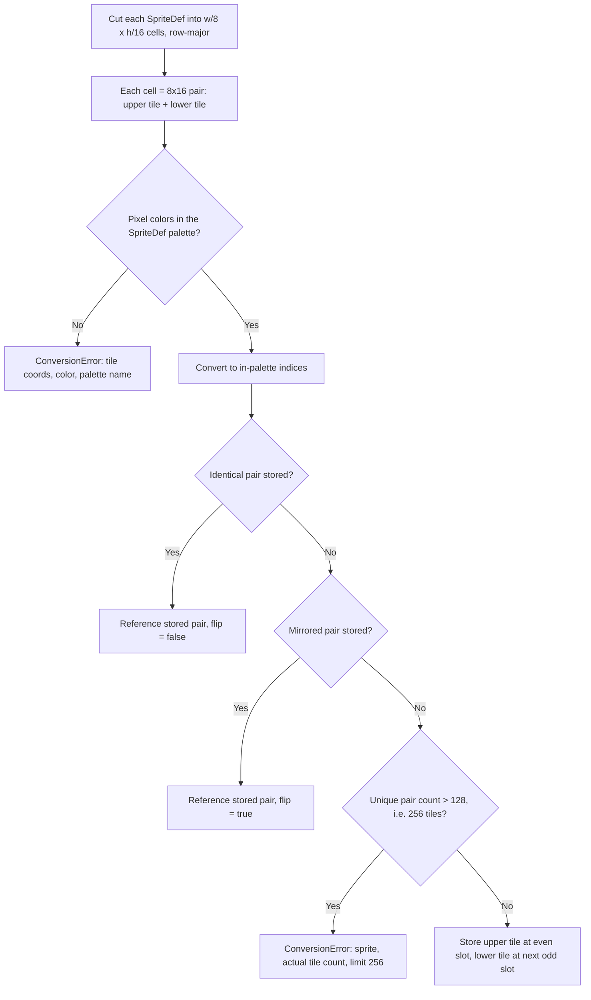
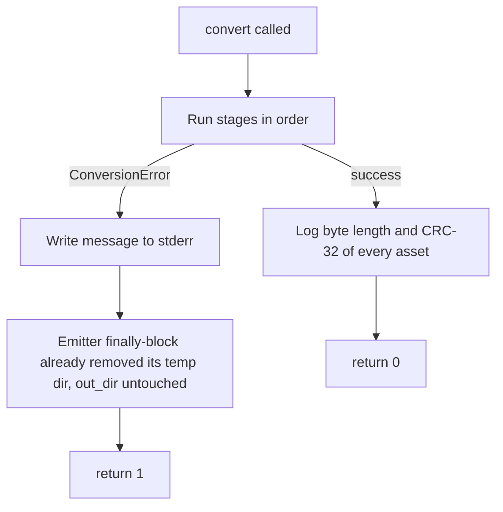

# Design Document

## Overview

This document defines the design of the asset conversion module (pipeline step 2) of Chronomicon.
The module reads one or more Pyxel `.pyxres` files and a Manifest (JSON/YAML) and deterministically produces the NES-format assets used by an iNES mapper 0 (NROM) ROM: `chr.bin`, `assets.h` and one `nametable_N.s` per screen.

Design principles:

- **Fail-fast**: the first validation error stops the conversion. Every error is a `ConversionError` carrying the context required by the requirements (coordinates, names, actual and limit values).
- **Deterministic**: identical input bytes give identical output bytes. No timestamps, randomness or dictionary-order dependence. Tile and slot assignment follows Manifest order, then row-major image order.
- **Atomic output**: all files are written to a temporary directory first and moved into `out_dir` only after the whole conversion succeeded. On failure `out_dir` is never touched.
- **No Pyxel at run time**: `.pyxres` files are read with `zipfile` and `tomllib`, and the Pyxel font is bundled as data in the repository.
- **Pure stages**: each stage is a function from immutable inputs to immutable outputs, so stages are easy to test with Hypothesis.

### Research summary: `.pyxres` layout

The layout below was checked against the current Pyxel source (`crates/pyxel-core/src/settings.rs`, `resource.rs`, `resource_data.rs`, `utils.rs` in [kitao/pyxel](https://github.com/kitao/pyxel)). Content was rephrased for compliance with licensing restrictions.

- A `.pyxres` file is a zip archive with one TOML entry named `pyxel_resource.toml`.
- The TOML starts with the top-level key `format_version` (an integer, currently up to 4). Pyxel itself writes version 1 for backward compatibility.
- Top-level arrays of tables: `[[images]]`, `[[tilemaps]]`, `[[sounds]]`, `[[musics]]`. Only the first two are used by this module. Array order is the bank number.
- `[[images]]` keys: `width`, `height`, `data`. `data` is an array of rows, each row an array of color indices (one integer per pixel).
- `[[tilemaps]]` keys: `width`, `height`, `imgsrc`, `data`. `imgsrc` is the number of the image bank the tilemap draws from. `data` is an array of rows, each row a flat array of `2 * width` integers: `tx, ty, tx, ty, ...`. `(tx, ty)` is the tile position in the image bank in units of 8 px.
- **Compression**: Pyxel stores `data` compressed. Trailing repeated values in a row are dropped, and trailing repeated rows are dropped. On load the last value of a row is repeated to fill the row, and the last row is repeated to fill the bank. The loader must implement this expansion, otherwise real files load as short arrays.
- Pyxel 2.x allows more than 16 colors in principle (up to 256), but this module accepts only 0-15 and rejects other values (Requirement 11.7).

All key names, the archive entry name and the supported version limit are isolated in one place, the `PYXRES_SCHEMA` constant of `pyxres_loader.py`. If a future Pyxel release renames a key, only that constant changes. The layout above was read from the repository `main` branch and not from a pinned release, so a smoke test loads a real `.pyxres` file saved by Pyxel (checked into `tests/data/`) to catch drift.

---

## Architecture

### Pipeline



The Manifest is loaded first because it names the `.pyxres` files. The loader runs second. Palette validation needs only the Manifest, but it runs after loading so that file errors (Requirement 7.1, 11) are reported first and bank-size checks of sprite definitions can use the loaded banks.

### Module dependencies



### Data flow



### File and directory layout

```
chronomicon/
├── THIRD_PARTY_NOTICES.md        # origin + full MIT text of bundled Pyxel font data
├── converter/
│   ├── __init__.py
│   ├── converter.py              # orchestrator and CLI entry point
│   ├── errors.py                 # ConversionError
│   ├── models.py                 # frozen dataclasses shared by all stages
│   ├── manifest.py               # Manifest loader and validator
│   ├── pyxres_loader.py          # Pyxres_Loader (zipfile + tomllib)
│   ├── palette.py                # Palette_Quantizer
│   ├── palette_map.py            # bg_palette_regions lookup and palette_map builder
│   ├── chr_encoder.py            # CHR_Encoder (BG and sprites)
│   ├── font_mapper.py            # Font_Mapper
│   ├── nametable.py              # Nametable_Builder
│   ├── attribute.py              # Attribute_Builder
│   ├── metasprite.py             # Metasprite_Builder
│   ├── emitter.py                # Emitter (temp dir, atomic move)
│   └── data/
│       ├── __init__.py
│       └── pyxel_font.py         # bundled 4x6 glyph bitmaps, ASCII 0x20-0x7E
├── tests/
│   ├── __init__.py
│   ├── strategies.py             # shared Hypothesis strategies
│   ├── pyxres_writer.py          # test helper: write_pyxres(path, banks, tilemaps)
│   ├── reference_renderer.py     # test support: render_nes_frame (NES-style reference renderer)
│   ├── data/
│   │   └── sample.pyxres         # real file saved by Pyxel, for the layout smoke test
│   ├── test_manifest.py
│   ├── test_pyxres_loader.py
│   ├── test_palette.py
│   ├── test_palette_map.py
│   ├── test_chr_encoder.py
│   ├── test_font_mapper.py
│   ├── test_nametable.py
│   ├── test_attribute.py
│   ├── test_metasprite.py
│   ├── test_emitter.py
│   ├── test_converter.py         # error handling, exit codes, atomic output
│   └── test_fidelity.py          # determinism and fidelity properties
├── check_nes.py                  # static checker for the 8-bit subset
└── pyproject.toml
```

`reference_renderer.py` and `pyxres_writer.py` live under `tests/` because they exist only to verify the converter. Nothing in `converter/` imports them.

---

## Components and Interfaces

### `errors.py`

```python
class ConversionError(Exception):
    """Aborts the conversion. The message is written to stderr by converter.py."""
```

### `models.py`

Holds all frozen dataclasses (see Data Models). Stages import their types from here, which avoids circular imports.

### `manifest.py` — Manifest loader and validator

```python
def load_manifest(path: str | Path) -> ManifestData:
    """Read JSON or YAML (by extension) and validate everything that does not need
    the loaded banks. Raises ConversionError."""

def validate_against_resources(manifest: ManifestData, resources: Resources) -> None:
    """Validate everything that needs the loaded banks and tilemaps:
    sprite rectangles inside their bank, screen/HUD tilemap numbers that exist."""
```

Validation in `load_manifest` (all fail-fast, in this order):

| Check | Requirement | Error content |
|---|---|---|
| Manifest file missing, `nes_colors` missing | 7.2 | missing field name |
| `bg_palette_regions` missing or empty | 2.8 | statement that no BG assignment exists |
| `screens` entry missing a field, `count` < 1 | 14.3 | entry position, field name |
| `SpriteDef.w % 8 != 0` | 12.2 | sprite name, `w` |
| `SpriteDef.h % 16 != 0` | 12.3 | sprite name, `h` |
| `SpriteDef.palette` not a defined sprite palette | 12.4 | sprite name, palette name |
| `bg_palette_regions` entry names an undefined BG palette | 13.6 | region, palette name |
| `objects` item names a sprite not in `sprites` | 9.3 (optional `objects`) | screen entry position, item position, unknown name |
| `objects` item `x` or `y` outside 0-255 | 9.3 (optional `objects`) | screen entry position, item position, field name, value |
| `objects` item `screen` outside 0..`count`-1 | 9.3 (optional `objects`) | screen entry position, item position, `screen` value, `count` |

`objects` is an optional list inside a `screens` entry. Design decision: each item carries an optional `screen` field (0-based index within the entry, default 0). A per-screen nested list would be more verbose, and applying one list to every screen of an entry would make it impossible to place different objects on different screens. Items are not required to be sorted, and the same sprite may appear several times.

Checks in `validate_against_resources`:

| Check | Requirement | Error content |
|---|---|---|
| `SpriteDef` rectangle outside its bank | 12.6 | sprite name, bank number, bank size |
| `screens` entry (or `hud_tilemap`) references a tilemap number the loader did not return | 14.4 | entry position, tilemap number |

`pyxres_files` order is kept as listed. When several files define the same bank or tilemap number, the first file in the list that defines it wins (the listing order is the priority order of Requirement 6.2). `Resources` is the ordered tuple of `PyxresData` with a lookup helper that applies this rule.

### `pyxres_loader.py` — Pyxres_Loader

```python
def load_pyxres(path: str | Path) -> PyxresData:
    """Open the zip archive, parse pyxel_resource.toml, return image banks and tilemaps
    in file order. Never imports pyxel."""
```

Implementation outline:

1. Open the path with `zipfile.ZipFile`. Map `OSError`/`FileNotFoundError` to the "cannot be read" error and `zipfile.BadZipFile` to the "not a valid zip archive" error.
2. Read the entry named `PYXRES_SCHEMA.archive_entry` (`pyxel_resource.toml`). A missing entry is a "missing entry" error.
3. Parse with `tomllib.loads` (Python 3.11+). On older Python the module imports `tomli` as a fallback (`pyproject.toml` declares `tomli; python_version < "3.11"`). `tomllib.TOMLDecodeError` becomes a "malformed TOML" error.
4. Check `format_version` is an integer not above `PYXRES_SCHEMA.max_format_version` (4).
5. For each `[[images]]` table: read `width`, `height`, `data`; expand the compressed rows (repeat the last value of a row up to `width`, repeat the last row up to `height`); check every value is in 0-15.
6. For each `[[tilemaps]]` table: read `width`, `height`, `imgsrc`, `data`; expand rows to `2 * width` values and the row list to `height` rows; fold each value pair into a `(tx, ty)` cell.
7. Return `PyxresData(images, tilemaps)`. `[[sounds]]` and `[[musics]]` are ignored.

`PYXRES_SCHEMA` is the single place that names `pyxel_resource.toml`, `format_version`, `images`, `tilemaps`, `width`, `height`, `data`, `imgsrc` and the maximum supported version.

Error cases (Requirement 11), each a `ConversionError` whose message contains the file path:

| Case | Requirement | Extra content in message |
|---|---|---|
| File missing or unreadable | 11.3 (and 7.1) | path |
| Not a zip archive | 11.4 | path |
| TOML malformed | 11.5 | TOML entry name |
| Expected entry missing (`pyxel_resource.toml`, `images`, `tilemaps`, or a required key) | 11.6 | name of the missing entry |
| Pixel value outside 0-15 | 11.7 | bank number, pixel position `(x, y)`, value |

Tile coordinates: the file stores `(tx, ty)` in 8 px units. `Tilemap.cells` keeps exactly what the file stores, so the loader round-trip is an identity on the stored data. The Pyxel tile coordinate `(u, v)` of the requirements (top-left pixel position) is `(8 * tx, 8 * ty)`, provided by the helper `cell_uv(cell)`.

Test helper (in `tests/pyxres_writer.py`, not shipped):

```python
def write_pyxres(path: Path, images: list[ImageBank], tilemaps: list[Tilemap],
                 compress: bool = False) -> None:
    """Write a .pyxres zip with one pyxel_resource.toml entry. Emits format_version = 1.
    With compress=True it applies Pyxel's trailing-repeat compression so that the
    loader's expansion is exercised."""
```

The helper serialises TOML by hand (the data is only integers and arrays), so no TOML writer dependency is needed.

### `palette.py` — Palette_Quantizer

```python
def build_palettes(manifest: ManifestData) -> PaletteSet:
    """Validate palettes against nes_colors and return the PaletteSet."""

def pyxel_to_nes(palette_set: PaletteSet, pyxel_color: int) -> int:
    """nes_colors lookup. Raises ConversionError for an unknown index (Requirement 2.6)."""
```

Checks, in order: `nes_colors` lookups for every palette color (2.1, 2.6); BG palette count and sprite palette count at most 4 (2.2, 2.7); each palette has at most 4 distinct colors (2.3, 2.4); color 0 of all BG palettes identical (2.9, the common background color). There is no RGB-nearest estimation and no automatic palette assignment (2.5).

A palette is defined by 1 to 4 Pyxel color indices. `PaletteDef.pyxel_colors[i]` is the Pyxel color that becomes in-palette index `i`. The NES byte of index `i` is `nes_colors[pyxel_colors[i]]`. For sprite palettes, index 0 is the transparent color.

### `palette_map.py` — BG palette regions and `palette_map`

```python
def bg_palette_of_tile(regions: tuple[BGPaletteRegion, ...], bank: int, u: int, v: int) -> str:
    """Name of the BG palette of the image tile whose top-left pixel is (u, v) in bank.
    Raises ConversionError when no region contains it (13.4) or two regions with
    different palettes contain it (13.5)."""

def build_screen_layouts(manifest, resources, palette_set) -> list[ScreenLayout]:
    """For every screen (numbered across entries in Manifest order) collect the 32x30
    grid of tile references (HUD rows 0-3 from the HUD source, BG rows 4-29 from the
    tilemap region) and the 32x30 palette_map."""
```

The palette of a tilemap cell is the palette of the image tile it references: the cell `(tx, ty)` of a tilemap with `imgsrc = b` references tile `(b, 8*tx, 8*ty)`, and that tile's top-left pixel is looked up in `bg_palette_regions`. The result is a 32x30 grid of BG palette numbers (0-3, the index of the palette in `bg_palettes`) per screen.

`ScreenLayout` holds, per screen: `screen_index`, `tiles` (30 rows x 32 columns of `TileRef(bank, u, v)`) and `palette_map`. Building layouts is where the bounds checks for screens happen, so that both the nametable builder and the CHR encoder consume one validated structure. The CHR encoder reads the set of referenced tiles from the layouts.

Palette map errors: tile in no region (13.4, message has bank, u, v), tile in two regions with different palettes (13.5, message has bank, u, v and both palette names). Overlapping regions that name the same palette are allowed.

### `chr_encoder.py` — CHR_Encoder

```python
def encode_bg_tiles(layouts, resources, palette_set, manifest) -> BGCHRResult:
    """Cut every referenced image tile into 8x8, convert to in-palette indices using
    the tile's BG palette, deduplicate, assign CHR slots."""

def encode_sprite_tiles(sprite_defs, resources, palette_set) -> SpriteCHRResult:
    """Cut each SpriteDef into 8x16 cells, deduplicate pairs (including mirrored
    pairs), assign pair slots in the sprite pattern table."""

def encode_tile(indices: Tile8x8) -> bytes:      # 16 bytes, plane 0 then plane 1
def decode_tile(chr16: bytes) -> Tile8x8:        # inverse, also used by tests
def hflip_pair(pair: SpritePair) -> SpritePair:  # mirror both tiles of an 8x16 pair
```

BG encoding flow:



The "actual count" in the capacity error is the number of unique non-blank tiles needed (not just the 162nd). To report it the encoder first deduplicates all tiles, then compares the count to 161, then assigns slots.

Sprite encoding flow:



Notes:

- Tile ids are assigned in a deterministic order: `.pyxres` listing order, then bank number, then row-major scan (top to bottom, left to right).
- Pair deduplication is by the pair as a unit. A pair whose upper or lower tile is blank is kept (Requirement 1.8).
- The OAM tile value of a pair is `(upper_slot) | 1` because sprites live in the `$1000` pattern table (bit 0 of the OAM tile byte selects the table in 8x16 mode). Since `upper_slot` is even, this equals `upper_slot + 1`.
- BG tiles are never flip-shared (the PPU cannot flip background tiles).
- A flipped match records `flip = true`. The Metasprite_Builder then sets bit 6 of the OAM attribute for the normal variant of such a cell, and clears it for the flipped variant, as part of the same toggle rule.

### `font_mapper.py` — Font_Mapper

```python
def encode_font(chr_bytes: bytearray) -> bytearray:
    """Write the 95 bundled glyphs (ASCII 0x20-0x7E) into BG pattern table slots
    equal to their ASCII codes. Returns the updated table."""

def get_pyxel_glyph_pixels(ascii_code: int) -> Tile8x8:
    """8x8 index array (stroke = 3, background = 0) for a glyph, read from the bundled
    data. Used by tests as the independent reference."""
```

Glyph source: `converter/data/pyxel_font.py` holds the 95 glyph bitmaps of the Pyxel built-in 4x6 font as a plain Python tuple of integers (one row bitmask per glyph row). The module has no imports and the Converter never imports `pyxel`. The origin of the data (Pyxel project, source file, MIT license) is recorded in the module docstring and in `THIRD_PARTY_NOTICES.md`.

Glyph encoding (Requirement 8.1, 8.2): a 4x6 glyph is placed at columns 0-3, rows 0-5 of the 8x8 tile. Stroke pixels are index 3, all other pixels (columns 4-7, rows 6-7, glyph background) are index 0. Slots 0x20-0x7E are reserved for the font, so the encoder skips them when assigning game tiles. `encode_font` is idempotent and writes each slot once.

`THIRD_PARTY_NOTICES.md` (repository root) states: the bundled font data comes from the Pyxel project by Takashi Kitao (https://github.com/kitao/pyxel), the file(s) it was taken from, and the complete text of the MIT License with the copyright line "Copyright (c) 2018 Takashi Kitao". The exact copyright year and notice text are copied from the LICENSE file of the Pyxel release used when the font data is extracted, and a test checks the notices file exists and contains the MIT permission sentence.

### `nametable.py` — Nametable_Builder

```python
def build_nametables(
    layouts: list[ScreenLayout],
    tile_to_chr_id: dict[TileRef, int],
) -> list[NametableData]:
    """Convert each screen's 32x30 grid of tile references into 960 CHR tile ids."""
```

Screen geometry (Requirements 3.1, 3.5, 14.2, 14.5):

- For an entry with `tilemap = t`, start `(x, y)`, count `N`, and screen index `i` in `0..N-1`, the BG area (rows 4-29, 32 columns x 26 rows) is read from tilemap `t` starting at tile `(x + 32*i, y + 4)`.
- The HUD area (rows 0-3, 32 columns x 4 rows) is read from tilemap `hud_tilemap` starting at `(hud_x, hud_y)`. All screens of an entry share the same HUD region.
- Screen indices are consecutive from 0 across entries in Manifest order, and from left to right inside an entry.
- Bounds (3.4): for every screen both regions must lie inside their tilemaps. The check is done while building layouts. The error message has the screen index, the tilemap number and the tilemap bounds.
- Each cell `(tx, ty)` becomes `TileRef(imgsrc, 8*tx, 8*ty)` and is converted with `tile_to_chr_id`. A missing entry is an error with the tilemap position `(column, row, screen index)` and `(u, v)` (3.7). An id outside 0-255 is an error with the id and `(column, row, screen index)` (3.3).

The nametable offset of cell `(col, row)` is `row * 32 + col`. HUD cells land in offsets 0-127 and BG cells in offsets 128-959.

### `attribute.py` — Attribute_Builder

```python
def build_attribute_table(screen_index: int, palette_map: list[list[int]]) -> AttributeTable:
    """32x30 palette_map -> 64-byte attribute table. Raises ConversionError on a
    palette number outside 0-3 or a 16x16 block with different palette numbers."""
```

Each attribute byte covers a 32x32 px area made of four 16x16 blocks:

```
bits 1:0 = top-left     16x16 block
bits 3:2 = top-right    16x16 block
bits 5:4 = bottom-left  16x16 block
bits 7:6 = bottom-right 16x16 block
```

The map has 15 block rows (30 tile rows / 2). The last attribute row covers only one block row, and its bottom-half bits (5:4, 7:6) are 0. A 16x16 block is the four 8x8 cells `(2c, 2r)`, `(2c+1, 2r)`, `(2c, 2r+1)`, `(2c+1, 2r+1)`. If their palette numbers differ the builder raises an error with the block coordinates (column 0-15, row 0-14) and the palette numbers involved (4.4). A palette number outside 0-3 raises an error with the value and position (4.6). The input comes from `palette_map.build_screen_layouts`, which is the only producer of a `palette_map`.

### `metasprite.py` — Metasprite_Builder

```python
def build_metasprites(sprite_defs, pair_map, sprite_tiles) -> MetaspriteTable:
    """For every SpriteDef build the normal variant, then derive the flipped variant."""

def flip_metasprite(entry: MetaspriteEntry, width: int) -> MetaspriteEntry:
    """x -> width - 8 - x, attr ^= 0x40. y and tile unchanged."""
```

Construction:

1. Decompose a `w x h` SpriteDef into `(w/8) x (h/16)` cells in row-major order (12.5). Cell `(cx, cy)` gets offsets `x = 8*cx`, `y = 16*cy`.
2. Look up the cell in `pair_map` to get its OAM tile (`upper_slot | 1`) and its stored-flip flag.
3. Attribute byte: bits 1:0 = sprite palette number, bit 6 = stored-flip flag. Other bits are 0.
4. Skip a cell if both its tiles have all in-palette indices equal to 0 (5.3). A cell with only one blank tile stays.
5. If one row has more than 8 hardware sprites, print a warning with the metasprite name and the count to stderr and continue (5.4).
6. Flipped variant (5.5): for each hardware sprite `x' = w - 8 - x` and `attr' = attr ^ 0x40`. `y` and `tile` stay. The tile pixels themselves are not duplicated: the PPU mirrors them because bit 6 is set. The hardware sprite order is kept, so the flip function is an involution (5.6): applying it twice returns the original entry.

Since mirroring is done by the PPU on each 8 px wide cell and the cell x positions are mirrored around the metasprite center, the whole metasprite appears mirrored.

### `emitter.py` — Emitter

```python
def emit_all(result: ConversionResult, out_dir: Path) -> EmitResult:
    """Write all files to a temporary directory, then move them into out_dir."""
```

Atomic output (Requirement 9.5, 7.8):

1. Create the temporary directory with `tempfile.mkdtemp(prefix=".chrono-", dir=out_dir.parent)`. Creating it next to `out_dir` (same filesystem) makes the final `os.replace` calls cheap and atomic per file. If the parent directory is not writable, fall back to the system temp directory and `shutil.move`.
2. Write `chr.bin`, `assets.h` and every `nametable_N.s` into the temporary directory and compute byte lengths and CRC-32.
3. On success: create `out_dir` with `os.makedirs(exist_ok=True)` if missing, then move each file into it with `os.replace` (the move happens only after everything was written and checked). Remove the temporary directory.
4. On any exception: remove only the temporary directory (`shutil.rmtree(..., ignore_errors=True)`) in a `finally` block and re-raise. `out_dir` and any files of an earlier successful run stay untouched.

`emit_all` does no work on `out_dir` before the last step, so a failure in an earlier stage of the pipeline never reaches it either. `converter.py` therefore needs no list of written files.

Output formats:

| File | Size | Content |
|---|---|---|
| `chr.bin` | always 8192 bytes | BG pattern table (`$0000`, 4096 bytes) then sprite pattern table (`$1000`, 4096 bytes). Unused bytes are 0. |
| `assets.h` | variable | palette arrays and metasprite data for cc65 |
| `nametable_N.s` | variable | ca65 data of screen N: nametable, attribute table, object placements |

**`assets.h`** (deterministic order: palettes, then metasprites in Manifest order, normal variant before flipped). Metasprites use the NESLib `oam_meta_spr` format: groups of four bytes `x_offset, y_offset, tile, attr`, terminated by the single byte `128`. Offsets are signed bytes and are written as `(unsigned char)-8` style casts for negative values (decimal for non-negative):

```c
/* Generated by Chronomicon. Do not edit. */
#ifndef ASSETS_H
#define ASSETS_H

const unsigned char palette_bg[16] = {
    0x0f,0x16,0x27,0x30,  0x0f,0x01,0x21,0x31,
    0x0f,0x19,0x29,0x39,  0x0f,0x06,0x16,0x26
};
const unsigned char palette_sprite[16] = { /* ... */ };

const unsigned char metasprite_player[] = {
    0, 0, 0x03, 0,
    8, 0, 0x05, 0,
    128
};
const unsigned char metasprite_player_flip[] = {
    8, 0, 0x03, 0x40,
    0, 0, 0x05, 0x40,
    128
};
#endif
```

Names are `metasprite_<name>` and `metasprite_<name>_flip`, where `<name>` is the SpriteDef name (validated to be a C identifier by the Manifest loader). The example is for a 16x16 sprite (`w = 16`), where `x' = 16 - 8 - x`.

**`nametable_N.s`**:

```asm
; Generated by Chronomicon. Screen 0.
.segment "RODATA"
.export _screen0_nametable, _screen0_attr, _screen0_objects

_screen0_nametable:        ; 960 bytes, 30 rows x 32 columns, rows 0-3 are the HUD
    .byte $20,$20,$20, ... ; 32 bytes per line
    ; ... 30 lines

_screen0_attr:             ; 64 bytes
    .byte $00,$55,$aa, ... ; 8 bytes per line

_screen0_objects:          ; initial object placements: x, y, metasprite index; ends with $ff
    .byte 40,120,0         ; example: sprites[0] at display (40, 120)
    .byte $ff
```

The object table is part of the output format (Requirement 9.3). It is filled from the optional `objects` list of the `screens` entry (see `ObjectDef`). For screen index `i` of an entry, the table holds the items whose `screen` equals `i`, in Manifest order, each as `.byte x, y, metasprite_index`, followed by `$ff`. `metasprite_index` is the position of the SpriteDef in the Manifest `sprites` list. If `objects` is absent or has no item for that screen, the table contains only `.byte $ff`.

The `y` stored in the table is the display Y (the screen row of the top of the object). The runtime subtracts 1 when it writes OAM, because the PPU draws a sprite one row below its OAM Y byte. This correction is not part of the converter output (see the reference renderer section).

### `converter.py` — orchestrator

```python
def convert(pyxres_override: list[str] | None, manifest_path: str | Path,
            out_dir: str | Path) -> int:
    """Run the pipeline. Return 0 on success, 1 on any ConversionError."""
```

`.pyxres` paths come from the Manifest (`pyxres_files`), resolved relative to the Manifest file. An optional override list exists for the CLI.



Cleanup strategy: stages before the Emitter create no files. The Emitter owns the only temporary directory and removes it in its own `finally` block. `convert` catches `ConversionError`, prints `error: <message>` and returns 1 (10). Non-`ConversionError` exceptions are not swallowed, but the Emitter's `finally` still removes the temporary directory. After a failure `out_dir` is byte-for-byte what it was before the run.

The success log lists, for each of `chr.bin`, every `nametable_N.s`, `assets.h` (which carries palettes and metasprites), the byte length and CRC-32 in hexadecimal (6.3). The log also reports the CRC-32 of the individual nametable, attribute table, palette and metasprite blocks computed before formatting.

---

## Data Models

```python
from dataclasses import dataclass
from pathlib import Path

Tile8x8 = tuple[tuple[int, ...], ...]    # 8 rows x 8 in-palette indices (0-3)
SpritePair = tuple[Tile8x8, Tile8x8]     # (upper, lower) 8x16 hardware sprite

# --- Pyxres loader ---

@dataclass(frozen=True)
class ImageBank:
    width: int
    height: int
    pixels: tuple[tuple[int, ...], ...]   # height rows x width Pyxel color indices (0-15)

@dataclass(frozen=True)
class Tilemap:
    width: int                             # in tiles
    height: int
    imgsrc: int                            # number of the image bank the cells point into
    cells: tuple[tuple[tuple[int, int], ...], ...]   # height rows x width (tx, ty), 8 px units

@dataclass(frozen=True)
class PyxresData:
    images: tuple[ImageBank, ...]          # index = bank number
    tilemaps: tuple[Tilemap, ...]          # index = tilemap number

# --- Manifest ---

@dataclass(frozen=True)
class PaletteDef:
    name: str
    pyxel_colors: tuple[int, ...]          # 1-4 Pyxel color indices; position = in-palette index

@dataclass(frozen=True)
class SpriteDef:
    name: str                              # C identifier
    image_bank: int
    u: int
    v: int
    w: int                                 # multiple of 8
    h: int                                 # multiple of 16
    palette: str                           # name of a sprite palette

@dataclass(frozen=True)
class BGPaletteRegion:
    image_bank: int
    u: int
    v: int
    w: int
    h: int
    palette: str                           # name of a BG palette

@dataclass(frozen=True)
class ObjectDef:
    name: str                              # name of a SpriteDef
    x: int                                 # display X in pixels, 0-255
    y: int                                 # display Y in pixels, 0-255 (the runtime writes y - 1 to OAM)
    screen: int = 0                        # 0-based screen index inside the entry, 0..count-1

@dataclass(frozen=True)
class ScreenDef:
    tilemap: int
    x: int                                 # start tile column
    y: int                                 # start tile row
    count: int                             # >= 1
    hud_tilemap: int
    hud_x: int
    hud_y: int
    objects: tuple[ObjectDef, ...] = ()    # optional initial placements

@dataclass(frozen=True)
class ManifestData:
    pyxres_files: tuple[str, ...]          # listing order = priority order
    nes_colors: dict[int, int]             # Pyxel color index -> NES 2C02 byte
    bg_palettes: tuple[PaletteDef, ...]    # at most 4
    sprite_palettes: tuple[PaletteDef, ...]  # at most 4
    bg_palette_regions: tuple[BGPaletteRegion, ...]
    sprites: tuple[SpriteDef, ...]
    screens: tuple[ScreenDef, ...]

@dataclass(frozen=True)
class PaletteSet:
    bg: tuple[PaletteDef, ...]
    sprite: tuple[PaletteDef, ...]
    nes_colors: dict[int, int]

# --- Screens ---

@dataclass(frozen=True)
class TileRef:
    bank: int
    u: int                                 # top-left pixel position of the image tile
    v: int

@dataclass(frozen=True)
class ScreenLayout:
    screen_index: int
    tiles: tuple[tuple[TileRef, ...], ...]       # 30 rows x 32 columns
    palette_map: tuple[tuple[int, ...], ...]     # 30 rows x 32 columns, values 0-3

# --- CHR ---

@dataclass(frozen=True)
class BGCHRResult:
    chr_bytes: bytearray                   # 4096 bytes, font slots still empty
    tile_to_chr_id: dict[TileRef, int]
    num_game_tiles: int                    # unique non-blank tiles, at most 161

@dataclass(frozen=True)
class SpritePairEntry:
    pair_index: int                        # 0-127
    h_flip: bool                           # True when stored mirrored

@dataclass(frozen=True)
class SpriteCHRResult:
    chr_bytes: bytearray                   # 4096 bytes
    cell_map: dict[tuple[str, int, int], SpritePairEntry]   # (sprite name, cx, cy) -> entry
    blank_cells: frozenset[tuple[str, int, int]]            # cells skipped by 5.3

# --- Nametable / attribute ---

@dataclass(frozen=True)
class NametableData:
    screen_index: int
    tile_ids: tuple[int, ...]              # 960 values, 0-255

@dataclass(frozen=True)
class AttributeTable:
    screen_index: int
    data: bytes                            # 64 bytes

# --- Metasprites ---

@dataclass(frozen=True)
class HWSprite:
    x_offset: int                          # signed byte
    y_offset: int                          # signed byte
    oam_tile: int                          # upper_slot | 1
    attributes: int                        # bits 1:0 palette, bit 6 horizontal flip

@dataclass(frozen=True)
class MetaspriteEntry:
    name: str
    width: int                             # SpriteDef.w in pixels
    hw_sprites: tuple[HWSprite, ...]
    is_flip: bool

@dataclass(frozen=True)
class MetaspriteTable:
    entries: tuple[MetaspriteEntry, ...]   # normal then flipped, per sprite, Manifest order

# --- Output ---

@dataclass(frozen=True)
class ConversionResult:
    chr_bin: bytes                         # 8192 bytes
    palette_set: PaletteSet
    nametables: tuple[NametableData, ...]
    attr_tables: tuple[AttributeTable, ...]
    metasprites: MetaspriteTable

@dataclass(frozen=True)
class EmitResult:
    files: dict[str, Path]
    checksums: dict[str, str]              # file name -> CRC-32 hex
    byte_lengths: dict[str, int]
```

`TileRef` includes the bank because a tilemap's `imgsrc` can differ between tilemaps, so `(u, v)` alone is ambiguous across banks.

### CHR memory layout

```
CHR (8192 bytes)
+-------------------------------------------------------------+
| BG pattern table  $0000-$0FFF  (256 tiles, 4096 bytes)      |
|   slots 0x00-0x1F  (32)   game BG tiles                     |
|   slots 0x20-0x7E  (95)   font glyphs, slot = ASCII code    |
|   slots 0x7F-0xFF  (129)  game BG tiles                     |
|   game slots total: 32 + 129 = 161; blank tiles use 0x20    |
+-------------------------------------------------------------+
| Sprite pattern table  $1000-$1FFF  (256 tiles = 128 pairs)  |
|   pair n: upper tile at slot 2n, lower tile at slot 2n+1    |
|   OAM tile byte = (2n) | 1  (bit 0 selects the $1000 table) |
+-------------------------------------------------------------+
```

---

## Test support: reference renderer

`tests/reference_renderer.py` is test-only code that renders converted output the way the PPU would. It is used by the fidelity property and nowhere else.

```python
def render_nes_frame(
    chr_bin: bytes,                       # 8192 bytes
    nametable: NametableData,
    attr: AttributeTable,
    bg_palettes: list[tuple[int, int, int, int]],       # NES bytes, 4 palettes
    sprite_palettes: list[tuple[int, int, int, int]],
    oam: list[OamEntry],                  # raw OAM bytes (y, tile, attr, x), in OAM order
) -> list[list[int]]:                     # 240 rows x 256 NES color bytes
```

The renderer draws sprites like real hardware: a sprite whose OAM Y byte is `Y` is drawn from screen row `Y + 1` (for 8x16 sprites, rows `Y+1 .. Y+16`). The `Y + 1` rule is applied inside the renderer, and the OAM list carries raw OAM bytes. Rows beyond 239 are clipped.

Background pass, for each pixel `(px, py)`:

1. `col, row = px // 8, py // 8`; tile id `= nametable.tile_ids[row*32 + col]`.
2. Read 16 bytes at `$0000 + id*16`, take bit `7 - (px % 8)` of plane 0 and plane 1 of row `py % 8` to get the 2-bit index.
3. Palette number: attribute byte at `(row // 4) * 8 + col // 4`; shift by `((row // 2) % 2) * 4 + ((col // 2) % 2) * 2`; mask 3.
4. Color: index 0 gives the common background color (`bg_palettes[0][0]`), otherwise `bg_palettes[n][index]`. The BG index is kept for the sprite priority test.

Sprite pass (8x16 mode), applied in reverse OAM order so lower OAM indices end on top:

1. For each OAM entry `(y, tile, attr, x)` the sprite covers columns `x..x+7` and rows `y+1..y+16`. Pixels outside 0-255 columns or 0-239 rows are clipped.
2. Pattern table is `$1000` if `tile & 1`, else `$0000`. The upper tile is `tile & 0xFE`, the lower tile is `(tile & 0xFE) + 1`.
3. Flip bits: bit 6 mirrors horizontally (`sx = 7 - sx`), bit 7 mirrors vertically over the whole 16 rows (`sy = 15 - sy`, which also swaps the tile halves).
4. In-sprite index 0 is transparent. Otherwise the pixel color is `sprite_palettes[attr & 3][index]`. Bit 5 (behind background) hides the sprite pixel where the BG index is not 0.
5. The 8-sprites-per-scanline limit is not emulated. Scenes used by the property keep to the project limit (at most 8 per scanline).

The OAM list for a scene is built by a test helper (`build_oam(metasprite, display_x, display_y)`) from the converter's own metasprite table. For each placement, each hardware sprite becomes the raw OAM entry `(display_y - 1 + y_offset, oam_tile, attributes, display_x + x_offset)` with signed offsets. Placing the flipped variant uses the `metasprite_<name>_flip` data. The resulting OAM Y byte must be in 0-239 (a Y byte of 240 or more puts the sprite below the visible area, where the renderer clips it). The scene generator avoids placements that would need an OAM Y of -1, that is, a display Y of 0 with a zero y offset.

Note: the y offsets in the converter's metasprite data (`assets.h`) are display offsets. The `-1` correction for the PPU's one-row sprite delay is the responsibility of the runtime (which writes `display_y - 1` to OAM, and also reads the object table `y` as display Y) and of this test helper. It is not part of `assets.h`.

---

## Correctness Properties

*A property is a characteristic or behavior that should hold true across all valid executions of a system—essentially, a formal statement about what the system should do. Properties serve as the bridge between human-readable specifications and machine-verifiable correctness guarantees.*

After the prework analysis, redundant candidates were merged: CHR round trip and Requirement 10.3 are one property; attribute range and bit layout are covered by one range property plus example tests for the bit layout; sprite pair dedup and flip sharing are one property. Error conditions, atomic output, file formats and the font/notices checks are not properties and are covered by example and edge-case tests (see Testing Strategy).

### Property 1: CHR encode/decode round trip

*For any* 8x8 array of in-palette indices (0-3) and *for any* 8x16 sprite pair, encoding to 2bpp CHR and decoding returns an array equal to the original.

**Validates: Requirements 1.10, 10.3**

### Property 2: Palettes never exceed four colors

*For any* valid Manifest palette definition, every palette produced by the Palette_Quantizer has at most 4 distinct NES color bytes, and at most 4 BG and 4 sprite palettes exist.

**Validates: Requirements 2.2, 2.3**

### Property 3: Attribute table entries are in range

*For any* conflict-free `palette_map` (32x30 values in 0-3, uniform inside each 16x16 block), the generated attribute table has 64 bytes and every 2-bit field of every byte is in 0-3, and decoding the fields gives back the block palettes of the input.

**Validates: Requirements 4.1, 4.2, 4.3, 4.5**

### Property 4: Metasprite flip symmetry

*For any* 8x16 sprite pair, rendering it with the horizontal flip flag set yields, at every pixel `(x, y)`, the index of the original pair at `(7 - x, y)`.

**Validates: Requirements 5.2**

### Property 5: Nametable tile ids stay in the CHR range

*For any* valid screen layouts and CHR id table, every tile id of every generated nametable is in 0-255 and the nametable has exactly 960 entries.

**Validates: Requirements 3.2, 3.5**

### Property 6: `chr.bin` is always 8192 bytes

*For any* valid conversion result, the emitted `chr.bin` is exactly 8192 bytes long.

**Validates: Requirements 9.1, 9.4**

### Property 7: BG tile deduplication

*For any* collection of BG tiles with duplicates, the number of game BG slots used equals the number of distinct non-blank in-palette index arrays, and blank tiles map to slot 0x20.

**Validates: Requirements 1.3, 1.7**

### Property 8: Sprite pair deduplication with flip sharing

*For any* collection of 8x16 sprite pairs with duplicates and mirrored duplicates, the number of stored pairs equals the number of distinct pairs when a pair and its horizontal mirror are treated as the same pair, and every input pair is reproduced exactly by its stored pair with its recorded flip flag.

**Validates: Requirements 1.8, 1.9**

### Property 9: Deterministic conversion

*For any* valid `.pyxres` bytes and Manifest, converting twice produces byte-identical `chr.bin`, `assets.h` and every `nametable_N.s`, and the set of output file names is the same.

**Validates: Requirements 6.1, 6.2**

### Property 10: Font glyph round trip

*For any* ASCII code in 0x20-0x7E, decoding CHR slot `code` after `encode_font` gives the glyph array from the bundled font data (stroke 3, background 0, glyph in columns 0-3 and rows 0-5, rest 0).

**Validates: Requirements 8.1, 8.2, 8.4**

### Property 11: Conversion fidelity

*For any* valid Pyxel scene (tiles, sprites placements and tilemaps within the 8-bit subset), the NES color byte at every pixel of the NES-style render of the converted output (CHR, palettes, nametable, attribute table, and metasprites for sprites) equals the NES color byte obtained by converting the original Pyxel image pixel by pixel through `nes_colors`.

**Validates: Requirements 10.1, 10.2**

### Property 12: Pyxres loader round trip

*For any* generated list of image banks (values 0-15) and tilemaps, writing them to a `.pyxres` archive (compressed or not) and loading the archive returns image banks and tilemaps equal to the generated ones, in the same order.

**Validates: Requirements 11.1, 11.2, 11.8**

### Property 13: `palette_map` consistency

*For any* tilemap region and any set of non-overlapping `bg_palette_regions` that cover every referenced tile, each cell of the generated `palette_map` equals the number of the palette of the region that contains the top-left pixel position of the tile the cell references.

**Validates: Requirements 13.2, 13.3, 13.8**

### Property 14: Metasprite flip involution

*For any* metasprite (any width that is a multiple of 8 and any hardware sprite list), applying the flip transformation (`x -> width - 8 - x`, toggle attribute bit 6, keep `y` and tile) twice returns the original metasprite, and one application keeps `y` and tile unchanged.

**Validates: Requirements 5.5, 5.6**

### Property 15: SpriteDef decomposition

*For any* `SpriteDef` with `w` a multiple of 8 and `h` a multiple of 16, the decomposition has exactly `(w/8) * (h/16)` cells, in row-major order, with offsets `(8*cx, 16*cy)`.

**Validates: Requirements 12.5**

---

## Error Handling

All modules raise `ConversionError`. `converter.py` prints the message to stderr and returns a non-zero exit code (7.10). Only the first error is reported (7.9). Messages always contain the context named in the requirements.

| Category | Module | Cases (requirement) |
|---|---|---|
| Resource file errors | `pyxres_loader.py` | file missing/unreadable (11.3, 7.1), not a zip (11.4), malformed TOML (11.5), missing entry (11.6), pixel outside 0-15 (11.7) |
| Manifest errors | `manifest.py` | Manifest missing or no `nes_colors` (7.2), no `bg_palette_regions` (2.8), screen entry field missing or `count` < 1 (14.3), screen tilemap number not loaded (14.4), `objects` item with unknown sprite name, `x`/`y` outside 0-255 or `screen` outside 0..`count`-1 (message has entry position, item position and offending value) |
| Sprite definition errors | `manifest.py` | `w` not a multiple of 8 (12.2), `h` not a multiple of 16 (12.3), undefined sprite palette (12.4), rectangle outside bank (12.6) |
| Palette errors | `palette.py` | color count over 4 (2.4), unknown Pyxel color (2.6), more than 4 palettes of a kind (2.7), BG color 0 mismatch (2.9) |
| Palette region errors | `palette_map.py`, `manifest.py` | undefined palette name in a region (13.6), tile in no region (13.4), tile in regions with different palettes (13.5) |
| CHR capacity and colors | `chr_encoder.py` | BG tiles over 161 (1.5), sprite tiles over 256 (1.6), pixel color not in assigned palette (1.11) |
| Screen and nametable errors | `palette_map.py`, `nametable.py` | screen or HUD region outside tilemap bounds (3.4), tile id outside 0-255 (3.3), missing `(u, v)` in CHR table (3.7) |
| Attribute errors | `attribute.py` | conflict inside a 16x16 block (4.4), palette number outside 0-3 (4.6) |
| Output errors | `emitter.py` | cannot create temp directory, cannot write, cannot move into `out_dir` |

Atomicity (7.8, 9.5): the Emitter is the only stage that touches the file system for output. Its temporary directory is removed in a `finally` block, and `out_dir` is modified only in the final move step. If a move fails halfway, the files already moved are the new complete set for those names, and the error is reported. To keep that window small the move loop runs after all files and checksums are final and uses `os.replace`.

Warnings (not errors): a metasprite row with more than 8 hardware sprites prints a warning to stderr and the conversion continues (5.4).

---

## Testing Strategy

PBT applies to this module: the stages are pure functions (encoders, builders, a parser/serialiser pair) with large input spaces. Libraries: `pytest` and `hypothesis`. No property-based testing framework is implemented from scratch.

### Dual approach

- **Property tests** (Hypothesis) check the 15 properties above. Each property is one test, configured with `@settings(max_examples=100)` or more, and tagged with a comment of the form `# Feature: asset-converter, Property N: <title>`.
- **Unit tests** (pytest) cover concrete examples, boundaries and every error message listed in Error Handling. Keep them few and specific: the properties already cover wide input ranges.

### Property test design

| Property | File | Generators and assertion |
|---|---|---|
| 1 CHR round trip | `test_chr_encoder.py` | 8x8 arrays of 0-3, pairs of two such arrays. `decode_tile(encode_tile(t)) == t`. |
| 2 Palette limit | `test_palette.py` | valid `ManifestData` with 1-4 colors per palette from a `nes_colors` table. Every palette has at most 4 distinct NES bytes. |
| 3 Attribute range | `test_attribute.py` | 15x16 block palette grid expanded to 32x30. Table is 64 bytes, all fields in 0-3, decoded fields equal block palettes. |
| 4 Flip symmetry | `test_metasprite.py` | random 8x16 pairs. Reference render with flip bit equals `pair[y][7-x]`. |
| 5 Nametable range | `test_nametable.py` | layouts with a CHR id table that has values in 0-255. All ids in 0-255, 960 entries. |
| 6 `chr.bin` size | `test_emitter.py` | small valid `ConversionResult` objects emitted to `tmp_path`. File size is 8192. |
| 7 BG dedup | `test_chr_encoder.py` | tile lists with injected duplicates and blank tiles. Slot count equals distinct non-blank arrays, blank maps to 0x20. |
| 8 Sprite dedup | `test_chr_encoder.py` | pair lists with identical and mirrored duplicates. Stored count equals distinct count under mirroring, and decoding each stored pair (with its flip flag) reproduces the input pair. |
| 9 Determinism | `test_fidelity.py` | small valid scenes written to `.pyxres` plus Manifest. Two runs into two directories. Compare `chr.bin`, `assets.h` and every `nametable_N.s` bytes. |
| 10 Font round trip | `test_font_mapper.py` | `sampled_from(range(0x20, 0x7F))`. Compare against `get_pyxel_glyph_pixels`. All 95 codes are also checked exhaustively in a unit test. |
| 11 Fidelity | `test_fidelity.py` | see below |
| 12 Loader round trip | `test_pyxres_loader.py` | banks of size 8..64 square with values 0-15, tilemaps with `imgsrc` in range. `write_pyxres(..., compress=draw(booleans()))` then `load_pyxres`, then equality. |
| 13 palette_map | `test_palette_map.py` | non-overlapping rectangle regions that tile the used part of the bank, tilemap cells referencing tiles inside them. Compare each cell to the region palette computed independently by a direct rectangle test. |
| 14 Flip involution | `test_metasprite.py` | widths 8..64 in steps of 8, up to 16 hardware sprites with signed offsets, any attribute byte. `flip(flip(m)) == m`; one flip keeps `y` and tile. |
| 15 Decomposition | `test_metasprite.py` | `w` in multiples of 8, `h` in multiples of 16. Cell count and row-major offsets. |

### Fidelity test (Property 11)

Scene generator (`tests/strategies.py`): picks a `nes_colors` table and palettes with at most 4 colors each; draws BG tiles (each tile uses one BG palette, tiles of one palette placed in one `bg_palette_regions` rectangle); draws a 32x30 tilemap whose attribute blocks are uniform in palette (the generator chooses one palette per 16x16 block, then draws tiles from that palette's region); draws sprite images (color 0 of the sprite palette is the transparent color) and a list of sprite placements, normal or flipped, with at most 8 per scanline. Counts stay within 161 BG tiles and 128 sprite pairs.

Expected image (a): start with the 256x240 Pyxel-side composite (BG tiles blitted from the tilemap, then sprites blitted at their placements with the transparent color skipped, mirrored for flipped placements), then map every pixel through `nes_colors`. No inverse mapping is used.

Actual image (b): run the real converter on the scene, then call `render_nes_frame` with the produced `chr.bin`, the palettes, the nametable and attribute table, and a raw OAM list built by `build_oam` from the produced metasprite data at the same placements (each OAM Y byte is `display_y - 1 + y_offset`, in 0-239). The renderer applies the `Y + 1` rule, so sprites appear at the desired display rows.

Assertion: `(a) == (b)` at every pixel. The test also checks that for every sprite palette the Pyxel-side color mapped to in-palette index 0 is never drawn.

### Unit and example tests

- **Loader** (`test_pyxres_loader.py`): the checked-in `tests/data/sample.pyxres` saved by real Pyxel loads and has the expected shape (guards the schema constants); one test per error case with a hand-built bad archive (missing file, not a zip, bad TOML, missing entry, pixel 16).
- **Manifest** (`test_manifest.py`): one test per row of the Manifest error tables (7.2, 2.8, 12.2-12.4, 12.6, 13.6, 14.3, 14.4) asserting the message contains the required items; valid JSON and YAML Manifests parse to equal `ManifestData`. Optional `objects`: absent and empty lists parse to an empty tuple, `screen` defaults to 0, and one test each for unknown sprite name, `x` or `y` outside 0-255 (also 256 and -1) and `screen` outside 0..`count`-1, asserting entry position and offending value in the message.
- **Palette** (`test_palette.py`): unknown color index, 5 colors, 5 palettes, BG color 0 mismatch.
- **Palette map** (`test_palette_map.py`): no region (13.4), conflicting regions (13.5), overlapping regions with the same palette are accepted.
- **CHR** (`test_chr_encoder.py`): exactly 161 BG tiles succeeds and 162 fails with the counts in the message; exactly 128 sprite pairs succeeds and 129 fails; slots 0x20-0x7E are never assigned; OAM tile is `upper | 1`; pair with one blank tile is kept; pixel color outside palette error.
- **Nametable** (`test_nametable.py`): HUD rows come from the HUD source and BG rows from `(x + 32*i, y + 4)`; screens numbered across entries; out-of-bounds region error; missing `(u, v)` error.
- **Attribute** (`test_attribute.py`): bit layout with a hand-computed byte; conflict error with block coordinates; palette 4 error.
- **Metasprite** (`test_metasprite.py`): empty-sprite skip vs one blank tile; 9 sprites in a row warns on stderr and continues; flipped example `x' = w - 8 - x`.
- **Emitter** (`test_emitter.py`): `assets.h` snapshot including the `128` terminator and `(unsigned char)-8` style negatives; `nametable_N.s` snapshot (960 + 64 `.byte` values); creates a missing `out_dir`. Object table snapshots: no `objects` gives only `.byte $ff`; items on different `screen` indices land in the right file in Manifest order with `.byte x, y, metasprite_index` followed by `$ff`; the metasprite index is the SpriteDef position in `sprites`.
- **Atomic output** (`test_converter.py`): inject a failure in the middle of the emit step and in an earlier stage; `out_dir` contents and mtimes are unchanged, the temporary directory is gone, exit code is 1. A successful run after a failed one replaces files completely.
- **Font and notices**: importing `converter` in a subprocess with `pyxel` blocked in `sys.modules` succeeds and converts a sample; `THIRD_PARTY_NOTICES.md` exists and contains the MIT permission sentence and the Pyxel project name.
- **Logging**: a successful run logs byte length and CRC-32 for each generated asset (6.3).

### Test support

`tests/pyxres_writer.py` (`write_pyxres`), `tests/reference_renderer.py` (`render_nes_frame`) and `tests/strategies.py` are test support only and are not part of the converter package.
