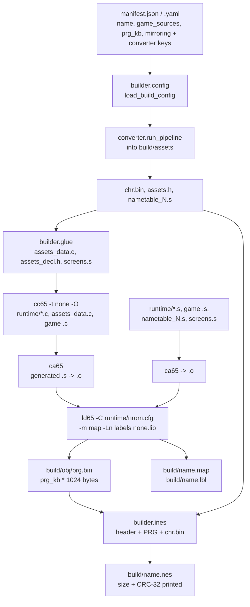
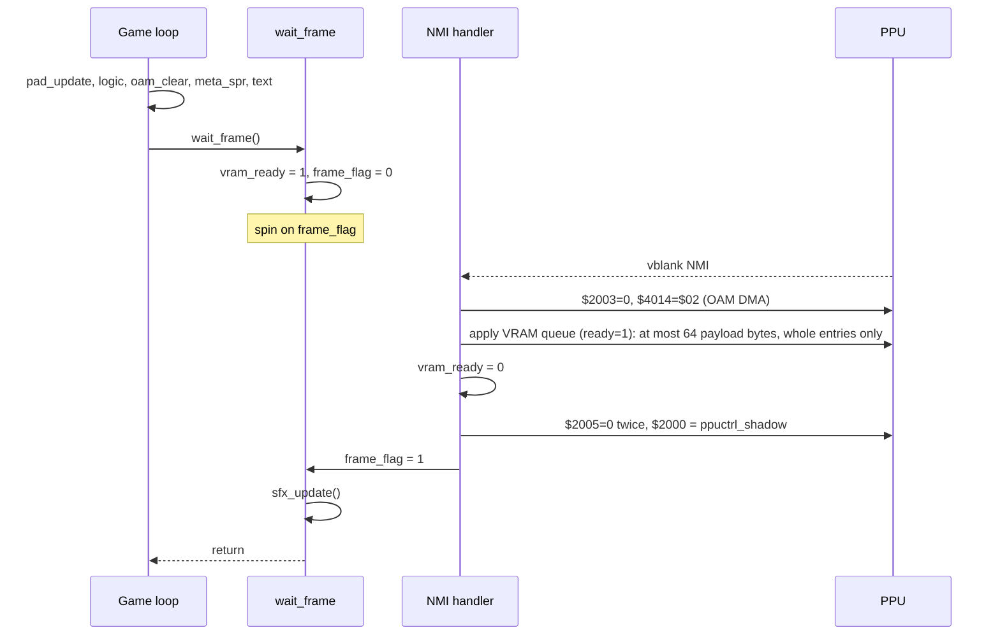

# Design Document

## Overview

The rom-builder feature turns the converter output plus a small C game into a playable `.nes` file (iNES, mapper 0 / NROM). It has three parts:

1. **Builder**: a new Python package `builder/` behind the `chrono build <manifest>` subcommand. It runs the Converter, compiles and assembles the Runtime, the game and the generated assets with cc65 2.19, links with ld65, writes the iNES header and produces `build/<name>.nes`.
2. **Runtime**: C and 6502 assembly in `runtime/` (own `crt0`, NMI handler, and a small Pyxel-like API: `wait_frame`, `pad_update`/`btn`/`btnp`, `meta_spr`, `text`, `load_screen`, `sfx`, password functions). No third-party runtime library other than cc65's own helper library `none.lib`.
3. **Verification**: a persistent Node driver around tinynes (`web/nes.js`), test ROMs built with the real Builder, static source checks, and Hypothesis property tests.

Design principles:

- **One pipeline, no special cases.** Test ROMs and the sample game are built by exactly the same `chrono build` code path as a user game.
- **Deterministic.** Fixed tool flags, sorted inputs, no timestamps. The `.nes` bytes depend only on the input files and the tool versions.
- **Fail loudly.** Every failure is a `BuildError` with the tool name, the file or the numbers that explain it. No tool is ever downloaded or installed.
- **Everything checkable.** The pitfalls in `steering/tech.md` become rules that a test can check (Requirement 10).

### Research findings that shaped the design

All findings below were verified locally with cc65 V2.19 (`C:\cc65`) and Node v24 in a scratch directory outside the repository. Nothing was installed.

| Finding | Consequence for the design |
|---|---|
| `cc65 -t none` generates `.forceimport __STARTUP__` in every C object. Without a definition, ld65 pulls the library `crt0.o` (and `condes.o`, which needs `__CONSTRUCTOR_COUNT__` etc.) and fails with unresolved symbols. | Our `crt0.s` exports `__STARTUP__ : absolute = 1`. Link with `C:\cc65\lib\none.lib` for `copydata`, `zerobss`, `zeropage` (26 bytes of cc65 zero page: `c_sp`, `sreg`, `regsave`, `ptr1-4`, `tmp1-4`, `regbank`) and the arithmetic helpers. `nes.lib` is rejected: it carries console-specific code and expects `nes.cfg` (PRG-RAM at `$6000`, which NROM boards do not have). |
| In cc65 2.19 the C stack pointer is `c_sp`. Importing `sp` links `sp-compat.s`, which raises a "deprecated" assertion warning. | `crt0.s` uses `.importzp c_sp`. |
| ld65 accepts `-D name=value`, and a `.cfg` can use weak symbols (`SYMBOLS { X: type = weak, value = ... }`) inside `MEMORY` expressions. A `MEMORY` area with `define = yes` named `PRG` already defines `__PRG_START__`, so a weak symbol with that name collides ("Duplicate external identifier"). | **One** `runtime/nrom.cfg` serves both PRG sizes. Weak symbols `CHRONO_PRG_START` (`$8000`) and `CHRONO_PRG_SIZE` (`$7FFA`) are overridden for 16 KB by `-D CHRONO_PRG_START=0xC000 -D CHRONO_PRG_SIZE=0x3FFA`. This satisfies Requirement 1.1 and 2 (the file is `runtime/nrom.cfg`) without two files and without generating a cfg. Both variants were linked: output sizes 32768 and 16384 bytes, vectors in the last 6 bytes. |
| With `fill = yes` on the PRG area plus a 6-byte vector area, `-o` produces exactly `prg_kb * 1024` bytes. | The Builder writes the iNES header and appends `chr.bin` itself in Python (the header is not part of the cfg). |
| ld65 overflow output (measured with a 40000-byte `RODATA` in a 32 KB cfg): stderr line `nrom.cfg:3: Warning: Segment 'RODATA' overflows memory area 'PRG' by 7388 bytes`, then `ld65: Error: Cannot generate most of the files due to memory area overflow`. Exit code 1, the map file **is** written, the output file is **not**. The map's segment list showed `RODATA 008096 011CD5`, so end + 1 - limit = `$11CD6 - $FFFA` = 7388, the same number. The quote characters in the message are locale dependent (UTF-8 curly quotes in this environment). | The Builder parses the segment list of the map file (primary source, as Requirement 1.4 says) and cross-checks with the stderr warning. Both regexes are tolerant about quote characters. stderr bytes are decoded as UTF-8 with `errors="replace"`. |
| `-Ln <file>` writes a label file with lines `al 000300 .name`. | Tests resolve RAM addresses of mailbox variables and routine addresses by symbol name instead of hard-coding them (see "Test harness"). |
| `#pragma bss-name (push, "OAM")` places a C array in the `OAM` segment. `#pragma zpsym ("name")` after `extern unsigned char name;` makes cc65 emit `.importzp _name`. Negative metasprite offsets in `assets.h` (`(unsigned char)-8`) compile. | The OAM shadow is defined in C (`oam.c`). The `assets.h` text from the Converter can be compiled as is. |
| `assets.h` **defines** its arrays (`const unsigned char palette_bg[16] = {...}`); it is not a declaration header. Two translation units including it would collide at link time. | The Builder generates `assets_data.c` (the only includer of `assets.h`) and `assets_decl.h` (extern declarations). `chrono.h` includes `assets_decl.h`. Game code never includes `assets.h`. |
| The Converter's `load_manifest` reads only the keys it knows (`pyxres_files`, `nes_colors`, palettes, regions, `sprites`, `screens`). Unknown top-level keys are silently ignored. | The new keys `name`, `game_sources`, `prg_kb`, `mirroring` are parsed by the Builder only. The Converter needs no change. |
| tinynes: `load()` resets the CPU; `read($4016)` returns `0x40 | bit` with the bits in LSB-first order (A first, bit 0), after a write of 1 then 0 to `$4016`; `write` and `read` are ordinary instance methods (can be wrapped for tracing); `indexBuffer` applies PPUMASK bit 0 (greyscale mask `0x30`), which the Runtime never sets; `vram` is the 2 KB CIRAM, `oam` the PPU OAM, `ram` the 2 KB CPU RAM. | Button constants use tinynes' bit order (A=1 ... RIGHT=128), which is also the order of 8 serial reads. The driver traces register writes by wrapping `nes.write`. |

### Key decisions

| # | Decision | Rationale |
|---|---|---|
| D1 | `chrono` becomes a dispatcher (`chrono convert ...`, `chrono build ...`). `chrono convert` forwards the remaining arguments unchanged to `converter.converter.main`, so its options and output cannot drift. `python -m converter` is untouched. | Requirements 1.10 to 1.12. No duplicated argument definitions. |
| D2 | One `runtime/nrom.cfg`, PRG window set with `-D`. | See research table. |
| D3 | `load_screen` suspends NMI by clearing PPUCTRL bit 7 (Requirement 8.2, first option). No "PPU suspend" flag in the NMI handler. | The NMI handler stays short and unconditional. The re-enable happens in vblank, which Requirement 8.4 asks for. |
| D4 | `wait_frame()` is a C function. After the frame flag is seen it calls `sfx_update()` (second note of `SFX_ITEM`). The NMI never touches game state. | Requirement 4.6 forbids game logic in the NMI. APU writes from the main thread are allowed by Requirement 9.3. |
| D5 | The NMI budget of 64 bytes counts **payload bytes** written to `$2007`. The 3-byte entry header (length, address high, address low) is not counted. | Requirement 4.2 and 7.5 talk about queued VRAM write bytes. The worst case (64 payload + 2 entries of headers) still fits in vblank after the 513-cycle OAM DMA (estimated under 1,600 cycles of the ~2,270 available). |
| D6 | `text()` is all or nothing. If the whole string (with headers) does not fit in the queue, it is dropped and a counter `vq_dropped` is incremented. Columns >= 32 and rows >= 30 are ignored. A string that would run past the end of the nametable (`$23BF`) is truncated there so it never writes attribute memory. | Predictable behaviour, no half-written messages. The truncation and the range check are design additions that keep Requirement 7.4 (contiguous addresses) intact for every string that fits the screen. |
| D7 | `load_screen(n)` with a valid `n` also empties the VRAM queue. | Queued text belongs to the old screen and would overwrite the new one. Out-of-range `n` changes nothing (Requirement 8.6). |
| D8 | Test mailboxes are located through the ld65 label file (`-Ln`), not through hard-coded addresses. Addresses are fixed at link time for a given ROM and are deterministic. | Requirement 12.9 says "fixed RAM addresses". A hard-coded address range would have to be reserved in `nrom.cfg` for every game (cost: 256 bytes of the 1 KB BSS). Symbol lookup gives the same determinism without that cost. Accepted (requirements Decision 14). |
| D9 | The Node driver is a persistent process (line-delimited JSON on stdin/stdout), started once per ROM and session. | A Hypothesis example then costs one JSON round trip instead of a Node start-up (~0.1 to 0.3 s), which keeps the 60 second budget. Requirement 11.8 (Node as a subprocess) holds. |

---

## Architecture

### Build pipeline



### Exact command lines

`<rt>` = runtime directory, `<as>` = `<build>/assets`, `<obj>` = `<build>/obj`. All paths are absolute in the real calls. Arguments are passed as a list (no shell), so paths with spaces are safe.

| Step | Command | Notes |
|---|---|---|
| Convert | in-process call of `converter.converter.run_pipeline(None, manifest, <as>)` | `<as>` is removed first so stale `nametable_N.s` files cannot be linked. |
| Compile C | `cc65 -t none -O --cpu 6502 -I <rt> -I <as> -o <obj>/<tag>.s <src.c>` | `-O` is the cc65 default optimiser level. No `-g`, no `--add-source`, so the assembler text has no timestamps. |
| Assemble | `ca65 --cpu 6502 -I <rt> -o <obj>/<tag>.o <src.s>` | Used for the output of the compile step, for `runtime/*.s`, game `.s`, `nametable_N.s` and `screens.s`. |
| Link | `ld65 -C <rt>/nrom.cfg [-D CHRONO_PRG_START=0xC000 -D CHRONO_PRG_SIZE=0x3FFA] -m <build>/<name>.map -Ln <build>/<name>.lbl -o <obj>/prg.bin <objects...> <lib>/none.lib` | The `-D` pair is added only for `prg_kb = 16`. `<lib>` is derived from the cc65 location (see tool discovery). |

Object order (fixed, so the output is deterministic): `runtime/*.s` sorted by name, `runtime/*.c` sorted by name, `assets_data.c`, `screens.s`, `nametable_N.s` sorted by N (numeric), game sources in the order of `game_sources`, then `none.lib`. `<tag>` is the source file stem (`runtime/pad.c` becomes `rt_pad`, a game file `main.c` becomes `game_main`). Duplicate stems in `game_sources` are rejected.

`ca65` flags contain no `-t` because the Runtime uses no target-specific includes. The Runtime avoids libc headers; `strlen`, `memcpy` and similar are written locally where needed.

### Memory map (`runtime/nrom.cfg`)

```text
SYMBOLS {
    CHRONO_PRG_START: type = weak, value = $8000;
    CHRONO_PRG_SIZE:  type = weak, value = $7FFA;   # up to the vectors
    __STACKSIZE__:    type = weak, value = $0100;
}
MEMORY {
    ZP:    file = "",  start = $0002,            size = $00FE, type = rw;
    OAM:   file = "",  start = $0200,            size = $0100, type = rw;
    RAM:   file = "",  start = $0300,            size = $0400, type = rw;   # $0300-$06FF
    STACK: file = "",  start = $0700,            size = __STACKSIZE__, type = rw, define = yes;
    PRG:   file = %O,  start = CHRONO_PRG_START, size = CHRONO_PRG_SIZE,
                       fill = yes, fillval = $FF;
    VEC:   file = %O,  start = $FFFA,            size = $0006;
}
SEGMENTS {
    ZEROPAGE: load = ZP,  type = zp;
    OAM:      load = OAM, type = bss, align = $100;
    BSS:      load = RAM, type = bss, define = yes;
    DATA:     load = PRG, run = RAM, type = rw, define = yes;
    STARTUP:  load = PRG, type = ro;
    CODE:     load = PRG, type = ro;
    RODATA:   load = PRG, type = ro;
    VECTORS:  load = VEC, type = ro;
}
```

Notes:

- The hardware stack page `$0100-$01FF` is not mapped to any segment. It is cleared at RESET and used only by `jsr`/`pha`.
- `STACK` (`define = yes`) gives ld65 the symbols `__STACK_START__` (`$0700`) and `__STACK_SIZE__` (`$0100`). `crt0.s` sets the cc65 C stack pointer `c_sp` to their sum (`$0800`); the C stack grows downwards from there, below the BSS (`$0300-$06FF`). Together they cover `$0300-$07FF` (Requirement 2.6).
- Zero page starts at `$0002` because `$0000-$0001` are left free. `none.lib`'s `zeropage.o` takes 26 bytes (`$02-$1B`); the Runtime's own zero-page variables follow.
- `__STACKSIZE__` is weak so a game can shrink the stack by `-D`; v1 does not expose this.
- The 16 KB variant puts the PRG at `$C000`; the vectors stay at `$FFFA`, which lies inside that window. No second file exists.

RAM budget at a glance:

| Range | Content | Size |
|---|---|---|
| `$0000-$0001` | unused | 2 |
| `$0002-$00FF` | cc65 zero page (26) + Runtime zero page (8: 6 shared + 2 NMI-only) + game zero page | 254 |
| `$0100-$01FF` | hardware stack | 256 |
| `$0200-$02FF` | OAM shadow | 256 |
| `$0300-$06FF` | `DATA` + `BSS` (Runtime: queue 128 + a few dozen bytes; game: the rest) | 1024 |
| `$0700-$07FF` | C stack | 256 |

### Frame timeline



---

## Components and Interfaces

### CLI and packaging

`pyproject.toml` changes:

```toml
[project.scripts]
chrono = "builder.cli:main"

[tool.setuptools.packages.find]
include = ["converter*", "builder*"]
```

`builder/cli.py`:

```python
def main(argv: Sequence[str] | None = None) -> int:
    args = list(sys.argv[1:] if argv is None else argv)
    if args[:1] == ["convert"]:
        return converter.converter.main(args[1:])      # unchanged options and output
    if args[:1] == ["build"]:
        return build_main(args[1:])
    print_usage(); return 0 if args[:1] in (["-h"], ["--help"]) else 2
```

- `chrono build <manifest> [-o BUILD_DIR] [--runtime-dir DIR]`. `-o/--build-dir` defaults to `build` (relative to the current directory, like the Converter's `-o build`); assets go to `<BUILD_DIR>/assets`, the ROM to `<BUILD_DIR>/<name>.nes`. `--runtime-dir` defaults to the `runtime/` directory next to the `builder` package (repository layout; an editable install is assumed for v1).
- Breaking change to note in the README: `chrono manifest.json` (old script behaviour) now prints a usage error; the old form is `chrono convert manifest.json` or `python -m converter manifest.json`.
- `converter/manifest.py` gets one public alias, `read_manifest_table = _read_raw` (no behaviour change), so the Builder reads JSON/YAML with the same rules and error messages as the Converter instead of importing a private name or duplicating the reader.

### Manifest fields and path resolution

| Field | Type | Default | Rule |
|---|---|---|---|
| `name` | string | required | `^[A-Za-z0-9_][A-Za-z0-9_.-]{0,63}$`, must not end with `.`, must not be a Windows device name (`CON PRN AUX NUL COM1-9 LPT1-9`, case-insensitive, also with an extension). Used as `<name>.nes`, `<name>.map`, `<name>.lbl`. |
| `game_sources` | list of strings | required, at least one `.c`/`.s` | Relative paths are resolved against the **directory of the manifest file** (same rule as `pyxres_files`). Absolute paths are accepted. Extension `.c` or `.s` (lower case). Each file must exist. Stems must be unique. |
| `prg_kb` | integer | `32` | 16 or 32. |
| `mirroring` | string | `"vertical"` | `"vertical"` or `"horizontal"`. |

Errors name the field. The error for a missing or unusable `name` contains the word `name` (Requirement 1.9). The Builder reads the manifest table first (before running the Converter), so a bad `name` fails before any tool starts.

### `builder/` package

| Module | Responsibility | Main interface |
|---|---|---|
| `errors.py` | `BuildError(Exception)` with `message`, `exit_code = 1` | |
| `config.py` | Manifest fields to `BuildConfig` | `load_build_config(manifest_path, build_dir, runtime_dir) -> BuildConfig`, `validate_name(name) -> str` |
| `tools.py` | Tool discovery and subprocess runner | `find_tools(which=shutil.which, environ=os.environ) -> ToolPaths`, `run_tool(argv, what) -> CompletedProcess` |
| `glue.py` | Generated files for the Runtime | `write_glue(assets_dir) -> GlueInfo` (screen count, extern names) |
| `linkmap.py` | ld65 map and diagnostics parsing | `parse_segment_list(text) -> list[Segment]`, `find_overflow(segments, prg_start, prg_size) -> Overflow | None`, `parse_ld65_overflow(stderr) -> Overflow | None`, `parse_labels(text) -> dict[str, int]` |
| `ines.py` | iNES header and ROM assembly | `build_ines_header(prg_kb, mirroring) -> bytes`, `assemble_rom(prg, chr_bin, prg_kb, mirroring) -> bytes` |
| `build.py` | Orchestration | `build(config, tools=None, log=print) -> BuildResult` |
| `cli.py` | Argument handling, exit codes | `main(argv) -> int` |

**Tool discovery** (`find_tools`): for each of `cc65`, `ca65`, `ld65`, `shutil.which(name)` (on Windows this honours `PATHEXT`). A missing tool raises `BuildError("required tool 'ld65' was not found on PATH; install cc65 2.19 and add its bin directory to PATH (this tool never installs anything)")`. The library directory is `$CC65_HOME/lib` when the environment variable is set, otherwise `<parent of the cc65 executable's directory>/lib`. `none.lib` must exist there, else a `BuildError` naming the file. The version printed by `cc65 --version` is compared with `2.19`; a different version prints a warning on stderr and continues.

**Build steps** (`build.build`), all inside one `try` that turns every failure into `BuildError`:

1. Load and validate the config (before anything else).
2. `find_tools()`.
3. Delete the previous `<build>/assets`, `<build>/obj` and `<build>/<name>.nes` (Builder-owned paths only; other files in the build directory are untouched). Creating `<build>/obj` afterwards.
4. `run_pipeline(...)`. A `ConversionError` or `OSError` becomes a `BuildError` carrying the Converter's message.
5. `write_glue(assets_dir)`; a gap in `nametable_N.s` numbering (not 0..N-1) or zero screens is a `BuildError`.
6. Compile and assemble every source (stdout/stderr of each tool are captured; on non-zero exit the message contains the tool name, the source and the tool's stderr; on success any stderr text is forwarded to stderr as warnings).
7. Link. On non-zero exit: read the map file (if it exists), call `find_overflow` then fall back to `parse_ld65_overflow(stderr)`; raise a `BuildError` containing segment name and overflow bytes when found, otherwise the raw ld65 stderr. No `.nes` is written.
8. Read `prg.bin`; its length must be `prg_kb * 1024` (else `BuildError("internal error: ...")`). Read `chr.bin`; its length must be 8192.
9. `assemble_rom`, write to `<name>.nes.tmp` in the build directory, `os.replace` to `<name>.nes`.
10. Print `build/<name>.nes: <size> bytes, crc32=<8 hex digits>` (lower case hex, zero padded, `zlib.crc32(rom) & 0xFFFFFFFF`) and return 0.

**Generated glue files** (`build/assets/`):

- `assets_data.c`: the single line `#include "assets.h"` (plus a comment). Defines `palette_bg`, `palette_sprite`, `metasprite_*`.
- `assets_decl.h`: one `extern const unsigned char NAME[];` for every `const unsigned char NAME[...] =` definition found in `assets.h` (regex `^const unsigned char (\w+)\[\d*\]\s*=`, multi-line). Included by `chrono.h` (`#include "assets_decl.h"`, found through `-I <as>`).
- `screens.s` (ca65): for `N` screens
  ```text
  .import _screen0_nametable, _screen0_attr, ...      ; all screens
  .export _screen_count, screen_nt_lo, screen_nt_hi, screen_at_lo, screen_at_hi
  .segment "RODATA"
  _screen_count:  .byte N
  screen_nt_lo:   .byte <_screen0_nametable, <_screen1_nametable, ...
  screen_nt_hi:   .byte >_screen0_nametable, >_screen1_nametable, ...
  screen_at_lo:   .byte <_screen0_attr, ...
  screen_at_hi:   .byte >_screen0_attr, ...
  ```
  The Converter does not emit such a table today, and its output stays unchanged. `N` is limited to 255 (one-byte index); more is a `BuildError`.

### Runtime layout

| File | Content |
|---|---|
| `runtime/chrono.h` | Public API: prototypes, `BTN_*`, `SFX_*`, `PASSWORD_MAX_STATE_LEN`, `PASSWORD_BUF_SIZE`, `btn`/`btnp` macros, `#include "assets_decl.h"`. |
| `runtime/chrono_zp.h` | `extern` declarations and `#pragma zpsym` lines for every zero-page symbol that assembly exports (Requirement 10.3). |
| `runtime/zp.s` | Defines the shared zero-page variables (`.segment "ZEROPAGE"`, `.exportzp`). |
| `runtime/crt0.s` | `reset`, `irq` (just `rti`), vectors, RAM clear, OAM hide, APU enable, reset upload. Exports `reset_handler`, `nmi_handler`, `irq_handler` (so they appear in the label file), `__STARTUP__`. |
| `runtime/nmi.s` | `nmi` handler and `.proc vram_apply`. |
| `runtime/screen.s` | `.proc screen_upload` (A = screen index) and `_load_screen` (`__fastcall__`, A = n). |
| `runtime/runtime.c` | `wait_frame`, `sfx_update` call, shared state (`vq_dropped`). |
| `runtime/pad.c` | `pad_update` (the only reader of `$4016`), `pad_now`, `pad_pressed`. |
| `runtime/oam.c` | `oam[256]` in segment `OAM`, `oam_count`, `oam_clear`, `meta_spr`. |
| `runtime/text.c` | `vq_buf` access, `vramq_push`, `text`. |
| `runtime/sfx.c` | `sfx`, `sfx_update`. |
| `runtime/password.c` | `password_encode`, `password_decode`. |

### `chrono.h` (public interface)

```c
#ifndef CHRONO_H
#define CHRONO_H
#include "assets_decl.h"                  /* palette_*, metasprite_* (generated) */

/* Buttons: bit i = i-th serial read of controller 1 (same bits as tinynes). */
#define BTN_A      0x01
#define BTN_B      0x02
#define BTN_SELECT 0x04
#define BTN_START  0x08
#define BTN_UP     0x10
#define BTN_DOWN   0x20
#define BTN_LEFT   0x40
#define BTN_RIGHT  0x80

extern unsigned char pad_now;             /* held, from the last pad_update()   */
extern unsigned char pad_pressed;         /* now & ~prev, from the last pad_update() */
#define btn(b)  ((pad_now & (b)) != 0)
#define btnp(b) ((pad_pressed & (b)) != 0)

void wait_frame(void);
void pad_update(void);
void oam_clear(void);
void meta_spr(unsigned char x, unsigned char y, const unsigned char *meta);
void text(unsigned char col, unsigned char row, const char *s);
void __fastcall__ load_screen(unsigned char n);
extern const unsigned char screen_count;

#define SFX_JUMP   0
#define SFX_HIT    1
#define SFX_SELECT 2
#define SFX_ITEM   3
void sfx(unsigned char id);

#define PASSWORD_MAX_STATE_LEN 8
#define PASSWORD_BUF_SIZE      15         /* 14 characters + NUL for len = 8 */
void password_encode(const unsigned char *state, unsigned char len, char *out);
unsigned char password_decode(const char *in, unsigned char len, unsigned char *state);
#endif
```

`btn`/`btnp` are macros over two C globals that only `pad_update()` writes; before the first `pad_update()` both are 0 because BSS is cleared (Requirement 5.8). They return 0 or 1.

### RESET sequence (`crt0.s`)

The order follows Requirement 3 exactly. Registers and bit numbers:

```text
reset:
    sei
    cld
    ldx #$40 : stx $4017            ; APU frame IRQ off
    ldx #$00 : stx $4010            ; DMC IRQ off
    ldx #$FF : txs                  ; stack pointer
    inx      : stx $2000            ; PPUCTRL = 0
               stx $2001            ; PPUMASK = 0
  @vb1: bit $2002 : bpl @vb1        ; vblank 1 (bit 7)
  @vb2: bit $2002 : bpl @vb2        ; vblank 2
    ; clear $0000-$07FF, no JSR, no push/pop (X = 0, A = 0)
  @clr: sta $0000,x : sta $0100,x : ... : sta $0700,x : inx : bne @clr
    ; cc65 start-up work (stack is usable from here)
    c_sp = __STACK_START__ + __STACK_SIZE__
    jsr zerobss : jsr copydata
    ; hide all 64 sprites: _oam[4*i] = $FF
    ; APU: $4015 = %00001011  (pulse 1, pulse 2, noise)
    ; palette: bit $2002; $2006 = $3F, $00; 16 bytes _palette_bg then 16 bytes _palette_sprite to $2007
    ; screen 0: A = 0, jsr screen_upload   (sets $2006 = $20,$00; 960 + 64 bytes to $2007)
    bit $2002 : lda #0 : sta $2005 : sta $2005     ; scroll 0
    lda #$A0 : sta ppuctrl_shadow : sta $2000       ; PPUCTRL
    lda #$1E : sta ppumask_shadow : sta $2001       ; PPUMASK
    jsr _main
  @halt: jmp @halt
```

PPUCTRL `$A0` = bit 7 NMI on, bit 5 8x16 sprites, bit 4 = 0 (BG pattern table `$0000`), bit 2 = 0 (increment 1), bits 1-0 = 0 (nametable `$2000`). PPUMASK `$1E` = bit 4 sprites, bit 3 BG, bit 2 sprites in left 8 px, bit 1 BG in left 8 px, bit 0 = 0 (no greyscale). Because the Converter guarantees byte 0 of every palette equals the backdrop, the 32-byte upload leaves `$3F00` equal to byte 0 of `palette_bg` even though `$3F10/$3F14/$3F18/$3F1C` mirror `$3F00/$3F04/$3F08/$3F0C` (pitfall 10, Requirement 10.6).

### Shared zero-page variables

Defined in `zp.s`, declared in `chrono_zp.h`. Only symbols that cross a file boundary are exported; temporaries local to one assembly file are not exported and need no pragma.

| Symbol | Size | Writer(s) | Reader(s) |
|---|---|---|---|
| `frame_flag` | 1 | NMI sets 1, `wait_frame` sets 0 | `wait_frame` |
| `vram_ready` | 1 | `wait_frame` sets 1; NMI and `load_screen` clear | NMI |
| `vq_head` | 1 | NMI (consumer), `load_screen` | `vramq_push`, NMI |
| `vq_tail` | 1 | `vramq_push` (producer), NMI (reset when drained), `load_screen` | NMI |
| `ppuctrl_shadow` | 1 | `crt0` | NMI, `load_screen` |
| `ppumask_shadow` | 1 | `crt0` | `load_screen` |
| `nmi_budget` | 1 | NMI (`vram_apply`) | NMI (`vram_apply`) |
| `nmi_len` | 1 | NMI (`vram_apply`) | NMI (`vram_apply`) |

`nmi_budget` and `nmi_len` are **NMI-only** (Requirement 10.7). They are reserved in the `ZEROPAGE` segment and are **not exported**: no other file and no C code refers to them, so they need no `.exportzp` and no `#pragma zpsym`. Requirement 10.3 covers only `.importzp`/`.exportzp` symbols, so rule S3 is not triggered. Because ca65 cannot share an unexported symbol between two files, the two `.res 1` lines sit at the top of `nmi.s` (`.segment "ZEROPAGE"`), next to their only user. `zp.s` keeps the exported shared variables only; this is a deliberate deviation from "define them in `zp.s`" so that no export (and no pragma) is needed.

The NMI zero-page footprint is **2 bytes** because `vram_apply` addresses the queue by index (`lda _vq_buf,x`, with X as the read position) and needs no pointer. A pointer variant would need `nmi_ptr` (2 bytes) plus `nmi_budget` and `nmi_len`, i.e. 4 bytes, plus `(zp),y` addressing that is slower per byte. The queue is 128 bytes, so an 8-bit index is sufficient.

**Rule for the NMI handler and everything it calls (Requirement 10.7):** the NMI interrupts C code at any instruction, so it must not touch cc65's shared zero page (`ptr1` to `ptr4`, `tmp1` to `tmp4`, `sreg`, `regsave`, `c_sp`, `regbank`). It saves and restores only A, X and Y (on the hardware stack) and uses only the Runtime variables above plus `ppuctrl_shadow`, `vram_ready`, `vq_head`, `vq_tail`, `frame_flag`. `screen_upload` is **not** part of the NMI call graph: it is called only from `reset` (before rendering and NMI are enabled) and from `_load_screen` (after PPUCTRL bit 7 is cleared), so it may use cc65 zero page (`ptr1`/`ptr2` for the table pointers and the copy loop). The static rule S5 keeps it out of the NMI call graph by checking that no routine reachable from `nmi` is `screen_upload`.

`chrono_zp.h` (included by `runtime.c`, `text.c`, `screen`-related C code and by the tests' ROM sources through `chrono.h`):

```c
extern volatile unsigned char frame_flag;  extern volatile unsigned char vram_ready;
extern unsigned char vq_head;              extern unsigned char vq_tail;
extern unsigned char ppuctrl_shadow;       extern unsigned char ppumask_shadow;
#pragma zpsym ("frame_flag")
#pragma zpsym ("vram_ready")
#pragma zpsym ("vq_head")
#pragma zpsym ("vq_tail")
#pragma zpsym ("ppuctrl_shadow")
#pragma zpsym ("ppumask_shadow")
```

### VRAM update queue

`vq_buf[128]` (BSS, exported from `text.c`, imported by `nmi.s` and `screen.s` as `_vq_buf`). Entries are stored back to back:

```text
[ len ][ addr_hi ][ addr_lo ][ payload byte 0 ] ... [ payload byte len-1 ]       1 <= len <= 32
```

- Producer (`vramq_push(addr, src, len)` in `text.c`): returns at once when `len == 0 || len > 32` (this is the zero-length guard of Requirement 10.1), otherwise appends the entry at `vq_tail`. The caller has already checked free space.
- Consumer (`vram_apply` in `nmi.s`): index-based, no pointer, no cc65 zero page (Requirement 10.7). X holds the read position (loaded from `vq_head`), Y counts payload bytes, `nmi_budget` starts at 64, `nmi_len` holds the current entry length.
  ```text
  .proc vram_apply
      ldx vq_head
      lda #64 : sta nmi_budget
  @next:
      cpx vq_tail : beq @done            ; queue empty
      lda _vq_buf,x                       ; entry length
      beq @corrupt                        ; ZEROLEN-GUARD: len = 0 is never written
      sta nmi_len
      lda nmi_budget : sec : sbc nmi_len
      bcc @done                           ; len > budget: entry stays, nothing partial (X still at its start)
      sta nmi_budget
      inx : lda _vq_buf,x : sta $2006     ; addr_hi
      inx : lda _vq_buf,x : sta $2006     ; addr_lo
      inx
      ldy nmi_len
  @copy:
      lda _vq_buf,x : sta $2007 : inx     ; payload byte
      dey : bne @copy
      stx vq_head                         ; whole entry consumed
      jmp @next
  @done:
      cpx vq_tail : bne @ret              ; entries left for a later NMI
  @corrupt:
      lda #0 : sta vq_head : sta vq_tail  ; drained, or corrupt: discard the queue
  @ret: rts
  .endproc
  ```
  Entries are applied whole and in order; `X <= 128` always, so one byte suffices. The routine writes only `$2006/$2007` and the variables listed in the zero-page table.
- Because `vram_ready` is set only while the game thread is blocked in `wait_frame`, producer and consumer never run at the same time. Entries left over (budget exhausted) are applied by a later NMI that has `vram_ready = 1`, i.e. after the game calls `wait_frame()` again; their order is preserved. New `text()` calls append behind them.
- `text()` free-space rule: `need = n + 3 * ceil(n / 32)` must be `<= 128 - vq_tail`, otherwise the call is dropped and `vq_dropped` is incremented.
- `text()` split rule: `n = min(strlen(s), 255, 960 - (row*32 + col))`, then consecutive chunks of 32 bytes (the last chunk 1 to 32 bytes) with `addr = 0x2000 + row*32 + col` advancing by the chunk size.

### NMI handler (`nmi.s`)

```text
nmi:
    pha : txa : pha : tya : pha            ; save A, X, Y
    lda #0   : sta $2003                   ; 4.1: first PPU write
    lda #$02 : sta $4014                   ; OAM DMA from $0200
    lda vram_ready : beq @scroll           ; 4.9: nothing written while the flag is clear
    jsr vram_apply                         ; 4.2, 4.3 (at most 64 payload bytes)
    lda #0 : sta vram_ready                ; 4.8
@scroll:
    bit $2002                              ; reset the address latch (read only)
    lda #0 : sta $2005 : sta $2005         ; 4.4: scroll writes are the last PPU writes ...
    lda ppuctrl_shadow : sta $2000         ; ... followed by the nametable bits of PPUCTRL
    lda #1 : sta frame_flag                ; 4.5
    pla : tay : pla : tax : pla            ; restore Y, X, A
    rti
```

No game logic runs here. `vram_apply` is a `.proc` so the static checker can find the `$2006/$2007` writes. The NMI call graph is exactly `nmi -> vram_apply`. It contains no `jsr` to C or to a cc65 library routine and no reference to `ptr1-4`, `tmp1-4`, `sreg`, `regsave`, `c_sp` or `regbank` (rules S5 and S6, Requirement 10.7). The handler preserves A, X and Y itself; it never needs the cc65 register save area.

### `wait_frame`, input, sprites, text, screens

`wait_frame()` (C, `runtime.c`):

```c
void wait_frame(void) {
    vram_ready = 1;          /* the queue is complete: the game thread is blocked here */
    frame_flag = 0;
    while (!frame_flag) { }  /* set by an NMI that happened after this call began */
    sfx_update();
}
```

If an NMI lands between the two stores, `frame_flag` is cleared again and the function waits for the next frame, which still satisfies "an NMI after the call began".

`pad_update()` (`pad.c`): `JOY1 = 1; JOY1 = 0;` (strobe, writes only), then eight reads `now = (now >> 1) | ((JOY1 & 1) << 7)`, so read 0 (A) ends in bit 0. `pad_pressed = now & ~prev; prev = now; pad_now = now;`. `$4016` appears only in this file.

`meta_spr(x, y, meta)` (`oam.c`): count the groups before the terminator byte 128 (`n`, stepping 4 bytes); if `oam_count + n > 64` return without writing; otherwise for each group write `oam[o] = y + dy - 1`, `oam[o+1] = tile`, `oam[o+2] = attr`, `oam[o+3] = x + dx`, all as `unsigned char` arithmetic (modulo 256), then `oam_count += n`. `oam_clear()` sets `oam[4*i] = 0xFF` for all 64 entries and `oam_count = 0` (called at frame start, so all entries are "unused").

`load_screen(n)` (`screen.s`, `__fastcall__`, `n` in A):

```text
    cmp _screen_count : bcs @ret          ; 8.6: out of range, nothing changes
    sta ls_n                              ; (local zero-page temp)
    jsr _wait_frame                       ; we are now just after an NMI
    lda ppuctrl_shadow : and #$7F : sta $2000     ; NMI off (PPUCTRL bit 7 = 0)
    lda #0 : sta $2001                            ; rendering off
    lda ls_n : jsr screen_upload                   ; 960 + 64 bytes to $2000, rendering off
    lda #0 : sta vq_head : sta vq_tail : sta vram_ready    ; D7
  @vb: bit $2002 : bpl @vb                ; wait for the next vblank by polling (NMI is off)
    lda #0 : sta $2005 : sta $2005        ; scroll 0 (the preceding bit $2002 reset the latch)
    lda ppuctrl_shadow : sta $2000        ; NMI on again
    lda ppumask_shadow : sta $2001        ; rendering on
  @ret: rts
```

Rendering is off from shortly after the NMI of frame k until the vblank of frame k+1, so at most one visible frame is lost (limit: 2, Requirement 8.4). `screen_upload` is the only routine with a block write of more than 32 bytes, and only `crt0` (rendering off) and `load_screen` call it (Requirement 8.3). `screen_upload` reads the table pointers `screen_nt_lo/hi` and `screen_at_lo/hi` indexed by A.

### Sound (`sfx.c`)

`$4015` is written once at RESET (`$0B` = pulse 1, pulse 2, noise). `sfx(id)` writes only `$4000-$4007` and `$400C-$400F`. Unknown ids return without any write.

| id | Channel | Writes (value tuning is by ear; addresses are the contract) |
|---|---|---|
| `SFX_JUMP` 0 | pulse 1, rising sweep | `$4000=$9F` (duty 50 %, constant volume 15), `$4001=$AB` (sweep on, period 2, negate = pitch rises, shift 3), `$4002=$A0`, `$4003=$10` (length index 2, about 170 ms) |
| `SFX_HIT` 1 | noise, short burst | `$400C=$1F`, `$400E=$07`, `$400F=$28` (length index 5, about 35 ms) |
| `SFX_SELECT` 2 | pulse 2, blip | `$4004=$97`, `$4005=$00`, `$4006=$7F`, `$4007=$38` (length index 7, about 50 ms) |
| `SFX_ITEM` 3 | pulse 2, two notes | note 1: `$4004=$9F`, `$4005=$00`, `$4006=$7F`, `$4007=$48`; sets `sfx_timer = 5`. `sfx_update()` (called by `wait_frame`) decrements the timer and, when it reaches 0, writes note 2: `$4006=$54`, `$4007=$48`. |

`sfx_update()` writes only when `sfx_timer != 0`, so a game that never uses `SFX_ITEM` produces no APU traffic from it.

### Password (`password.c`)

- Alphabet (value 0..31, index = value): `ABCDEFGHJKLMNPQRSTUVWXYZ23456789` (24 letters without `I` and `O`, then digits 2-9; verified: 32 distinct symbols). All ASCII codes are within `0x20-0x7E`.
- `D(len) = ceil(8*len / 5)` data symbols, `N(len) = D(len) + 1`. For `len = 8`: `D = 13`, `N = 14`.
- **Encode**: view `state` as a bit string, byte 0 first, each byte MSB first. Symbol `i` (0 <= i < D) is the 5 bits at bit offset `5*i`, MSB first; bits past `8*len` are 0. `check = (sum of the D symbol values) mod 32`. Output: the D data characters, the character for `check`, then NUL. A caller buffer of `N + 1` bytes (`PASSWORD_BUF_SIZE = 15` covers every length) is enough. `len` outside `1..8` writes `out[0] = 0` (empty string, defined behaviour for misuse).
- **Decode** validation order (each step returns 0 and leaves `state` untouched on failure):
  1. `len` in `1..PASSWORD_MAX_STATE_LEN`.
  2. Count characters of `in` up to the first NUL, looking at no more than `N + 1` bytes; the count must equal `N` (so an unterminated or too long string is rejected without scanning memory).
  3. Every character maps to a value through the alphabet (rejects lowercase, `I`, `O`, `0`, `1`, space and anything else).
  4. `sum of the D data values mod 32` equals the value of the last character.
  5. Rebuild the bytes into a local `tmp[8]` (padding bits are ignored), copy `len` bytes to `state`, return 1.
- Single-character substitution of a data symbol changes the sum by a non-zero amount modulo 32 (the difference is in `1..31`), and a substituted check character differs from the stored sum, so detection is deterministic.
- The Python oracle is `tests/password_ref.py` (`ALPHABET`, `data_len(n)`, `encode(state: bytes) -> str`, `decode(pw: str, n: int) -> bytes | None`) with the same step order; it is what the C code is compared with (Requirement 12.9).

### Test harness

**Node driver `tests/node/rom_server.js`** (requires `../../web/nes.js`; no other dependency). Protocol: one JSON object per line on stdin, one JSON object per line on stdout. Binary data is base64.

```text
{"id":1,"op":"load","rom":"<base64 .nes>"}                      -> {"id":1,"ok":true}
{"id":2,"op":"run","trace":{"ppu_data":true,"io":true,"apu":true},
 "steps":[
   {"frames":6},                                                 // boot, no input
   {"writes":[{"addr":1792,"data":"<base64>"}],                  // CPU RAM writes (addr < 0x800), applied before the step's frames
    "hold":[0,0,8,8,0],                                          // optional per-frame button mask (int = same mask for every frame)
    "frames":5,
    "reads":[{"name":"oam","addr":512,"len":256}],               // CPU RAM reads after the step
    "snap":["index_buffer","oam","vram","pal"]}                  // optional full snapshots after the step
 ]}
-> {"id":2,"ok":true,"steps":[{"reads":{"oam":"<b64>"},"snap":{"index_buffer":"<b64 61440 bytes>"},
                               "ppu_data_per_frame":[0,0,...],"io":[[frameIdx,addr,value],...],"apu":[[frameIdx,addr,value],...]}, ...]}
```

Each `run` builds a fresh `new NES()` and loads the cached ROM (so every Hypothesis example starts from power-on). Tracing wraps `nes.write` on the instance: `ppu_data` counts writes to `$2007` per frame, `io` lists writes to `$2000-$2007` and `$4000-$4017` in order (with the frame index), `apu` lists writes to `$4000-$4017` only. `hold` calls `setButton(0, mask-bit, bool)` before each `frame()`. Errors return `{"ok":false,"error":"..."}` and never kill the process.

**Python side `tests/rom_harness.py`**:

```python
class RomRunner:                     # context manager, one Node process per ROM
    def __init__(self, rom: Path): ...          # skips the test when node is missing
    def run(self, steps, trace=None) -> list[StepResult]: ...
def read_labels(lbl: Path) -> dict[str, int]    # '_pw_cases' -> 0x0300 ...
def need_node() -> str                          # shutil.which("node") or pytest.skip("Node.js not found on PATH ...")
```

Session fixtures (in `tests/conftest.py`, appended; the Hypothesis profile code stays as is):

- `rom_project` (session, `tmp_path_factory`): writes `tests/rom_fixtures.py`'s deterministic project (one `.pyxres` written with `tests/pyxres_writer.py`, three manifests) once.
- `boot_rom`, `password_rom`, `runtime_rom` (session): run `chrono build` through `builder.build.build` once each and return `BuiltRom(nes, map, lbl, build_dir)`. Missing cc65 tools or Node produce a skip with a clear message; setting `CHRONO_REQUIRE_TOOLCHAIN=1` turns those skips into failures (for CI).
- `boot_runner`, `password_runner`, `runtime_runner` (session): a started `RomRunner` per ROM.

**Mailbox ROMs** (C, built with the real Builder; manifests share the fixture assets and differ in `name` and `game_sources`):

`tests/rom/password_rom.c`:

```c
#define PW_CASES 16
struct pw_case {            /* 32 bytes: offsets op 0, len 1, state 2..9, pw 10..25, result 26 */
    unsigned char op;       /* 0 = idle, 1 = encode, 2 = decode */
    unsigned char len;
    unsigned char state[8];
    char          pw[16];
    unsigned char result;   /* decode return value */
    unsigned char pad[5];
};
struct pw_case pw_cases[PW_CASES];
unsigned char pw_count, pw_ctrl;     /* driver sets pw_ctrl = 1; ROM sets 2 when done */
void main(void) { for (;;) { wait_frame(); if (pw_ctrl == 1) { /* run every case */ pw_ctrl = 2; } } }
```

`tests/rom/runtime_rom.c` (one command per run, results read back by the driver):

```c
unsigned char rt_cmd, rt_done;       /* driver writes rt_cmd; ROM clears it and increments rt_done */
unsigned char rt_arg[32];            /* command arguments */
unsigned char rt_meta[96];           /* metasprite blob(s) in RAM */
unsigned char rt_str[128];           /* NUL-terminated string */
unsigned char rt_dump[130];          /* rt_dump[0] = vq_tail, then vq_buf[0..tail) */
unsigned char cnt_held, cnt_edge;    /* counts of btn(BTN_A) and btnp(BTN_A) per frame */
/* rt_cmd: 1 META (rt_arg[0] = calls, then x, y, offset into rt_meta per call; ROM calls oam_clear first)
           2 TEXT (rt_arg[0] = col, rt_arg[1] = row, string in rt_str)
           3 TEXT_DUMP (like 2, then copies the queue into rt_dump before the next wait_frame)
           4 LOAD_SCREEN (rt_arg[0] = n) */
```

Each ROM's main loop calls `wait_frame(); pad_update();` and counts buttons every frame, then handles `rt_cmd`.

**Timing in tests**: `boot = 6` frames (two vblank waits, RAM clear and uploads take about 3 frames); the driver writes the mailbox after the boot step and runs 3 to 5 more frames. Button patterns are padded with idle frames at both ends, so a constant one-frame sampling offset cannot change edge counts.

### Static checks (`tests/test_runtime_static.py`)

Pure Python over the files in `runtime/`. Comments are stripped first (`;` in `.s`, `/* */` and `//` in `.c/.h`). `.proc NAME ... .endproc` blocks are located by regex.

| Rule | Check |
|---|---|
| S1 (10.2, 5.7) | The tokens `4016` (as `$4016` or `0x4016`) appear only in `runtime/pad.c`. In `pad.c` the register macro `JOY1` is read only inside the body of `pad_update` (brace matching). |
| S2 (10.5) | The tokens `$2006`, `$2007`, `0x2006`, `0x2007` appear only in `crt0.s`, `nmi.s`, `screen.s`; inside `nmi.s` only within `.proc vram_apply`; inside `screen.s` only within `.proc screen_upload`; inside `crt0.s` only inside `.proc reset` (the palette upload) . No `.c` or `.h` file contains them. |
| S3 (10.3) | Let `E` = names in `.importzp` / `.exportzp` in `runtime/*.s`, minus the cc65 library names `{c_sp, sreg, regsave, regbank, ptr1..ptr4, tmp1..tmp4}`, with the leading underscore removed. Every name in `E` has a `#pragma zpsym ("name")` in `runtime/*.c` or `runtime/*.h`. |
| S4 (10.1) | In `text.c` the body of `vramq_push` starts with a guard matching `if\s*\(\s*len\s*==\s*0`. In `nmi.s`, inside `vram_apply`, the line that loads the entry length is followed by the marker `; ZEROLEN-GUARD` and a `beq`. |
| S5 (10.7) | Build the call graph of `runtime/*.s`: nodes are labels and `.proc` names (local `@labels` belong to the enclosing node); edges are the targets of `jsr` and `jmp` (a `jmp` to a local `@label` stays inside the node). The NMI set is every node reachable from the label `nmi` (today `nmi` and `vram_apply`). In the text of every node of that set (comments stripped), no whole-word, case-insensitive match of `ptr1`, `ptr2`, `ptr3`, `ptr4`, `tmp1`, `tmp2`, `tmp3`, `tmp4`, `sreg`, `regsave`, `c_sp`, `regbank` (also with a leading underscore) may occur. A `jsr`/`jmp` target that is not a node of `runtime/*.s` (a cc65 library helper such as `tosmula0`, or an unknown symbol) also fails, because library helpers use `ptr`/`tmp`/`sreg`. `screen_upload` must not be in the NMI set. |
| S6 (10.7) | No node of the NMI set contains a `jsr` or `jmp` to a C function. A target is a C function when its name is defined as a function in `runtime/*.c` (name without the leading `_`), or when it starts with `_` and is not defined as a label or `.proc` in `runtime/*.s`. Data symbols such as `_vq_buf` (used by `lda`/`sta`, not `jsr`) are allowed. |

Rules are applied through functions such as `find_register_uses(text, token) -> list[(line, enclosing_proc_or_function)]` so the tests of the rules themselves can run on small synthetic strings.

### Sample game (`samples/boot_test/`)

`main.c`:

```c
#include "chrono.h"
void main(void) {
    unsigned char px = 64;
    for (;;) {
        wait_frame();
        pad_update();
        if (btnp(BTN_START)) px += 16;
        oam_clear();
        meta_spr(px, 120, metasprite_player);
    }
}
```

`manifest.json` is generated by `tests/rom_fixtures.py` (the `.pyxres` is created by `tests/pyxres_writer.py`, never checked in): `name = "boot_test"`, `game_sources = ["main.c"]`, `prg_kb = 32`, `mirroring = "vertical"`, plus the converter keys. Fixture content: two screens (`count = 2`, screen 0 and 1 clearly different), at least 3 distinct BG tiles using at least 2 BG palettes, the font mapped by the Converter, one 8x16 sprite `player` (one hardware sprite with `x_offset = 0`, `y_offset = 0`). The same project dir holds the manifests of `password_rom` and `runtime_rom`. The sample checks `metasprite_player` through `chrono.h` (extern declaration from `assets_decl.h`).

**Boot test** (Requirement 11): load the ROM, run 30 frames with no input, read `index_buffer`, `ram[0x200..0x2FF]`, `oam`. The expected frame is `render_nes_frame(chr_bin, nametable_0, attr_0, bg_pal, sp_pal, [])` where `chr_bin`, `nametable_0` (960 bytes from `nametable_0.s`) and `attr_0` come from the files in `build/assets/` (the `.s` bytes are parsed with a small helper `read_asm_bytes`) and `(bg_pal, sp_pal) = upload_palette(bytes(palette_bg + palette_sprite))` with the arrays parsed from `assets.h` (same bytes as the ROM uploads). Both frames are masked: for each of the 64 OAM entries in `ram[0x200..0x2FF]` with `Y != $FF`... every pixel in columns `X .. X+7` and rows `Y+1 .. Y+16` (clipped to the frame) is excluded, regardless of Y value, exactly as Requirement 11.6 states. The remaining pixels must match with zero differences; on failure the test reports the count and the first `(x, y)`. Then `START` is held for one frame (`hold: [8]`), idle frames follow, and `ram[0x203]` must be 64 before and 80 after. As an extra check of OAM DMA the test also compares PPU `oam[3]` (80) after one more frame.

### Reset, vector and memory-map example tests

Using the same boot ROM, its map and its label file:

- Vectors (2.3): the last 6 bytes of the PRG part of the ROM are the little-endian addresses of `nmi_handler`, `reset_handler`, `irq_handler` from the label file.
- Memory map (2.1 to 2.7): from the map's segment list: the lowest PRG segment start equals `$8000` (16 KB build: `$C000`) via `__DATA_LOAD__`; every `ZEROPAGE` range inside `$00-$FF`; `OAM` starts at `$0200` and is at most 256 bytes; `BSS`/`DATA` inside `$0300-$06FF`, `__STACK_START__ = $0700`, `__STACK_START__ + __STACK_SIZE__ = $0800`; no two segment ranges overlap. One 16 KB build is made for the 2.2 check.
- RESET order (3.1 to 3.7): `trace.io` of the first frames: the first writes are `$4017=$40`, `$4010=$00`, `$2000=$00`, `$2001=$00`; then `$4015=$0B`; the first `$2006` pair is `$3F,$00` followed by 32 `$2007` writes equal to `palette_bg + palette_sprite`; the next `$2006` pair is `$20,$00` followed by 1024 `$2007` writes equal to nametable 0 and attribute 0; then `$2005` twice with `0`, `$2000 = $A0`, `$2001 = $1E`.

---

## Data Models

```python
@dataclass(frozen=True)
class BuildConfig:
    manifest_path: Path
    name: str
    game_sources: tuple[Path, ...]          # absolute, order preserved
    prg_kb: int                             # 16 or 32
    mirroring: str                          # "vertical" | "horizontal"
    build_dir: Path
    runtime_dir: Path
    # derived: assets_dir, obj_dir, rom_path, map_path, label_path, prg_start, prg_size
    #   prg_start/prg_size = ($8000, 0x7FFA) for 32, ($C000, 0x3FFA) for 16

@dataclass(frozen=True)
class ToolPaths:
    cc65: Path; ca65: Path; ld65: Path
    lib_dir: Path                           # directory that holds none.lib

@dataclass(frozen=True)
class Segment:                              # one row of the map file's "Segment list"
    name: str; start: int; end: int; size: int

@dataclass(frozen=True)
class Overflow:
    segment: str; bytes: int

@dataclass(frozen=True)
class BuildResult:
    rom_path: Path; size: int; crc32: int

class BuildError(Exception):
    exit_code = 1
```

**Exit codes**: `0` success; `1` any `BuildError` or Converter failure (message `error: ...` on stderr); `2` command-line usage error (argparse default, unknown subcommand).

**iNES header** (16 bytes): `4E 45 53 1A`, `prg_kb // 16`, `1`, `flags6 = 1 if vertical else 0`, then 9 zero bytes (bytes 7-15). `assemble_rom` returns `header + prg + chr_bin` and raises `ValueError` if `len(prg) != prg_kb * 1024` or `len(chr_bin) != 8192`.

**ld65 map "Segment list" row** (as measured): `RODATA                008096  011CD5  009C40  00001`. Parsed with `^(\w+)\s+([0-9A-Fa-f]{6})\s+([0-9A-Fa-f]{6})\s+([0-9A-Fa-f]{6})\s+[0-9A-Fa-f]+\s*$`.
`find_overflow(segments, prg_start, prg_size)`: PRG-resident segments are those named `STARTUP`, `CODE`, `RODATA` (and `ONCE`, `LOWCODE` when present); `limit = prg_start + prg_size`; the culprit is the first of them (by start address) with `end + 1 > limit`; `bytes = max(end + 1 of those segments) - limit`. `DATA` is listed at its run address in RAM, so its load size in PRG is not visible in the list; an overflow caused by it is found by `parse_ld65_overflow`, the stderr fallback: `Segment\s+\W*(\w+)\W*\s+overflows memory area\s+\W*(\w+)\W*\s+by\s+(\d+)\s+bytes`.

**Label file** (`-Ln`): lines `al <hex address> .<symbol>`; `parse_labels` returns `{symbol: address}`. C globals appear with a leading underscore (`_pw_cases`).

**Mailbox encodings** are the C structs above; Python packs them with `struct` formats `"<BB8s16sB5x"` (`pw_case`) and plain byte slices for the runtime ROM.

**Python models used by property tests** (in `tests/models.py`, pure functions):

```python
def split_text(col, row, s: bytes) -> list[tuple[int, bytes]]:     # D6 clipping, 32-byte chunks
def queue_entries(chunks) -> bytes                                   # [len, hi, lo, payload...]*
def model_oam(calls, blobs) -> bytes                                 # Requirement 6 behaviour on a 256-byte shadow
def count_edges(pattern: list[bool]) -> tuple[int, int]              # (held frames, rising edges)
```

---

## Correctness Properties

A correctness property is a characteristic or behavior that should hold true across all valid executions of a system, a formal statement about what the system should do. Properties are the bridge between human-readable specifications and machine-verifiable correctness guarantees.

Reflection done before writing the list: the header and layout criteria (1.2, 1.3) became one property, because layout checking needs the header anyway. The `btn` and `btnp` criteria (5.5, 5.6) use the same experiment and are one property. The OAM criteria 6.1 to 6.6 and 10.4 are all observations of one 256-byte shadow compared with one model, so they are one property. The queue-format criteria (7.1 to 7.4, 10.1) and the queue-application criteria (4.2, 4.3, 7.5, 7.6) are two properties because the first inspects the queue before the NMI and the second inspects PPU traffic after it. The Python-oracle password properties (round trip, single substitution, rejection) stay separate from the C-versus-oracle property, because the oracle must be right on its own before it can serve as a reference. The NMI zero-page criterion (10.7) is one property over a call-graph checker. Criteria that are single scenarios (boot test, RESET order, memory map, vectors, load of screen N, sfx register values) are example or integration tests and are not listed here.

### Property 1: iNES header and ROM layout

*For any* `prg_kb` in {16, 32}, any `mirroring` in {vertical, horizontal}, any PRG byte string of length `prg_kb * 1024` and any CHR byte string of length 8192, `assemble_rom` returns `header + prg + chr` with total length `16 + prg_kb * 1024 + 8192`, where the header is 16 bytes: `4E 45 53 1A`, PRG bank count `prg_kb / 16`, CHR bank count 1, byte 6 equal to 1 for vertical and 0 for horizontal (so bit 0 is the mirroring bit and mapper bits are 0), and bytes 7 to 15 equal to 0. Slices `rom[16:16+prg_kb*1024]` and the tail equal the inputs exactly.

**Validates: Requirements 1.2, 1.3**

### Property 2: Manifest name validation

*For any* string `s`, `validate_name(s)` either returns `s` or raises a `BuildError` whose message contains the word `name`. When it returns `s`, then `s` has no path separator or drive/colon characters, `Path(s).name == s`, `s` is not a Windows device name (with or without extension), does not end with a dot or space, and is at most 64 characters long. A non-string value or a missing field raises the same error.

**Validates: Requirements 1.8, 1.9**

### Property 3: PRG overflow detection

*For any* PRG window (16 KB or 32 KB) and any sequence of PRG segments (`STARTUP`, `CODE`, `RODATA`) laid out one after the other with generated sizes, rendering them as an ld65 map "Segment list" and parsing it back, `find_overflow` returns `None` when the total size fits the window, and otherwise returns the first segment whose end passes the limit together with `total - window` bytes. The stderr parser `parse_ld65_overflow` run on a rendered warning line with arbitrary quote characters (ASCII or UTF-8 curly) returns the same segment name and byte count.

**Validates: Requirements 1.4**

### Property 4: Password round trip and shape (oracle)

*For any* `len` in 1..8 and any `state` of `len` bytes, `encode(state)` has exactly `ceil(8*len/5) + 1` characters, every character is in the 32-symbol alphabet, and `decode(encode(state), len) == state`. The last character equals the sum of the other symbol values modulo 32.

**Validates: Requirements 12.3, 12.4, 12.5, 12.6**

### Property 5: Password single-substitution detection (oracle)

*For any* valid password produced by `encode`, any character position (data or checksum) and any alphabet symbol different from the original at that position, `decode` of the modified password returns failure.

**Validates: Requirements 12.5, 12.7**

### Property 6: Password rejection and untouched state (oracle)

*For any* `len` and any input string that has the wrong length, contains a character outside the alphabet (including lowercase letters, `I`, `O`, `0`, `1`, space), has a wrong checksum, or is paired with `len = 0` or `len > 8`, `decode` returns failure and the caller's state buffer is returned unchanged.

**Validates: Requirements 12.7**

### Property 7: C password code agrees with the oracle

*For any* batch of up to 16 cases (encode of random state and length; decode of a valid password; decode of a one-symbol-corrupted password; decode of a malformed string), running the cases in the test ROM under tinynes gives exactly the oracle's output: identical encode strings, identical decode result codes (1 or 0), identical decoded bytes on success, and the pre-filled sentinel bytes unchanged on failure.

**Validates: Requirements 12.4, 12.5, 12.6, 12.7, 12.9**

### Property 8: `text()` queue contents follow the split model

*For any* `col` in 0..31, `row` in 0..29 and any ASCII string of 0 to 150 characters, after `text(col, row, s)` the VRAM queue equals the model `queue_entries(split_text(col, row, s))` when the whole string fits in the free queue space, and is unchanged when it does not fit. Every queued entry has length in 1..32, the first entry targets `0x2000 + row*32 + col`, each following entry targets the address right after the previous entry's last byte, the concatenated payloads equal the (possibly truncated at `$23BF`) string, and an empty string queues nothing.

**Validates: Requirements 7.1, 7.2, 7.3, 7.4, 10.1**

### Property 9: Queue application respects the per-frame budget

*For any* string accepted by `text()` and `wait_frame()` calls afterwards, the number of `$2007` writes in every frame is at most 64, entries are never split across frames (each frame's count is a sum of whole entries), the writes are applied in queue order, and after enough frames nametable 0 at the target address holds exactly the string bytes and the queue is empty.

**Validates: Requirements 4.2, 4.3, 7.5, 7.6**

### Property 10: `meta_spr` writes the OAM shadow according to the model

*For any* sequence of 1 to 8 `meta_spr(x, y, meta)` calls after `oam_clear()`, where each metasprite has 0 to 24 groups with arbitrary signed offsets, tile and attribute bytes, and `x`, `y` range over 0..255, the 256-byte OAM shadow equals the model: groups are appended in order as bytes `(y + dy - 1) & 0xFF, tile, attr, (x + dx) & 0xFF`; a call whose group count does not fit in the remaining entries (64 in total) writes nothing and leaves every existing entry unchanged; every unused entry has Y = `$FF`.

**Validates: Requirements 6.1, 6.2, 6.3, 6.4, 6.5, 6.6, 10.4**

### Property 11: `btn` and `btnp` follow the held pattern

*For any* sequence of 0 to 20 per-frame hold states for one button, padded with idle frames on both ends, the count of frames where `btn(b)` is true equals the number of held frames, and the count of frames where `btnp(b)` is true equals the number of rising edges of the sequence (a held press is reported by `btnp` in exactly one frame).

**Validates: Requirements 5.5, 5.6, 5.7, 10.2**

### Property 12: `sfx` touches only permitted APU registers

*For any* id in 0..255, `sfx(id)` followed by enough frames for `sfx_update` produces APU writes only to addresses in `$4000-$4007`, `$400C-$400F` and `$4015`, never to `$4010-$4013` or `$4017`; and for every id outside 0..3 it produces no APU write at all.

**Validates: Requirements 9.3, 9.5**

### Property 13: `load_screen` ignores out-of-range screens

*For any* `n` in `screen_count..255`, `load_screen(n)` returns without writing PPUMASK (`$2001`), without any `$2006/$2007` write and with nametable 0 unchanged.

**Validates: Requirements 8.6**

### Property 14: Palette upload keeps the backdrop

*For any* backdrop colour `b` in 0..63 and any other palette bytes in 0..63 such that offsets 0, 4, 8, 12 of both `palette_bg` and `palette_sprite` equal `b`, `upload_palette(bytes(palette_bg + palette_sprite))` returns background palettes whose `[0][0]` equals `b` and sprite palettes whose entry 0 equals `b` for each of the four palettes.

**Validates: Requirements 10.6**

### Property 15: Frame comparison reports the exact difference

*For any* two 256x240 index frames and any sprite-mask derived from an OAM shadow, the comparison helper returns a difference count equal to the number of unmasked positions where the frames differ, and the first differing coordinate in row-major order (or no difference when the frames match outside the mask). Masked pixels cover columns `X..X+7` and rows `Y+1..Y+16` of every OAM entry, clipped to the frame.

**Validates: Requirements 11.5, 11.6, 11.10**

### Property 16: The NMI call graph never touches cc65 zero page or C code

*For any* set of assembly routines (generated nodes with random `jsr`/`jmp` edges, random instruction text, and a random subset of nodes containing a reference to one of `ptr1`-`ptr4`, `tmp1`-`tmp4`, `sreg`, `regsave`, `c_sp`, `regbank`, or a `jsr` to a C function or an external library symbol), the checker reports a violation if and only if such a node is reachable from `nmi`; nodes that are not reachable from `nmi` never cause a violation. The real `runtime/*.s` and `runtime/*.c` sources produce no violation.

**Validates: Requirements 10.7**

---

## Error Handling

| Situation | Behaviour | Exit code | Requirement |
|---|---|---|---|
| `cc65`, `ca65` or `ld65` not on PATH | `error: required tool 'ld65' was not found on PATH ...`; nothing is run or installed | 1 | 1.7 |
| `none.lib` missing under the derived/`CC65_HOME` lib directory | `error:` naming the file and the directory searched | 1 | 1.7 |
| Manifest unreadable, malformed, or missing `name` / unusable `name` | `error:` naming the field `name` (or the converter's own message) before any tool runs | 1 | 1.9 |
| `game_sources` empty, file missing, wrong extension, duplicate stem | `error: manifest field 'game_sources': ...` with the offending entry | 1 | 1.1 |
| `prg_kb` not 16/32, `mirroring` not vertical/horizontal | `error:` naming the field and the allowed values | 1 | 1.2 |
| Converter failure (`ConversionError`, `OSError`) | `error:` with the Converter's message | 1 | 1.1 |
| No `nametable_*.s`, or numbering not 0..N-1, or N > 255 | `error: converter produced screens ...` | 1 | 8.1 |
| cc65 / ca65 compile or assemble error | `error: <tool> failed on <file>` followed by the tool's stderr; no `.nes` | 1 | 1.1 |
| ld65 overflow of the PRG window | `error: segment 'RODATA' overflows the 32 KB PRG window by 7388 bytes`; no `.nes`; any older `<name>.nes` was already deleted at the start | 1 | 1.4 |
| ld65 other failure (unresolved symbol, ...) | `error: ld65 failed` followed by its stderr | 1 | 1.1 |
| `prg.bin` or `chr.bin` has an unexpected size | `error: internal error: ...` naming file and sizes | 1 | 1.3 |
| Command line misuse (unknown subcommand, missing manifest) | usage text on stderr | 2 | 1.10, 1.11 |
| `text()` string does not fit the queue | dropped whole, `vq_dropped` incremented, no error | n/a | 7 (design D6) |
| `text()` with col >= 32 or row >= 30 | ignored | n/a | 7 (design D6) |
| `load_screen(n)` with `n >= screen_count` | returns at once, no PPU access | n/a | 8.6 |
| `sfx(id)` with an unknown id | returns, no APU access | n/a | 9.5 |
| `password_encode` with `len` outside 1..8 | writes an empty string | n/a | 12 |
| `password_decode` with bad `len`, length, character or checksum | returns 0, `state` untouched | n/a | 12.7 |
| Corrupt queue entry with length 0 at NMI | queue discarded, no zero-length loop | n/a | 10.1 |
| Node missing during tests | test skipped with "Node.js not found on PATH" | n/a | 11.9 |
| cc65 missing during tests | skipped with a message; fails instead when `CHRONO_REQUIRE_TOOLCHAIN=1` | n/a | 11.1 |
| Driver error (bad ROM, request error) | `{"ok":false,"error":...}`, test fails with that message, process stays alive | n/a | 11.8 |

---

## Testing Strategy

PBT applies to this feature: the Builder's header, name and map parsing are pure functions, and the Runtime's `meta_spr`, `text`, queue draining, button logic and password code have input-dependent behaviour that can be compared with small Python models through tinynes. PBT does not apply to the toolchain orchestration (tool invocation, linker script, startup code), which is tested with integration and example tests.

**Library:** Hypothesis, already a dev dependency. Profiles come from `tests/conftest.py` (`dev` = 25 examples, `ci` = 200 examples). Each property test is one `@given` test tagged with a comment `# Feature: rom-builder, Property N: <title>` and `# Validates: Requirements ...`. The workflow default of 100 iterations is met by the `ci` profile; the `dev` profile stays at 25 because of the 60 second budget in `steering/tech.md`.

### Test files

| File | Content |
|---|---|
| `tests/test_builder_pure.py` | Properties 1, 2, 3; config loading examples; tool discovery with an injected `which`; CLI routing (`convert` forwarded unchanged, `build`, exit codes 0/1/2); map parsing examples with the measured ld65 output; header example for each of the four combinations. |
| `tests/test_runtime_static.py` | Rules S1 to S6 on `runtime/` (S5 and S6 are Requirement 10.7; Property 16 runs the call-graph checker on generated routine sets), plus positive/negative tests of the rule functions on small synthetic strings; static structure checks (two vblank polls before the RAM clear, no `jsr` inside the clear, NMI register save/restore, no C imports in `nmi.s`, `chrono.h` declarations and constants). |
| `tests/test_build_rom.py` | Integration: boot ROM build (exit code, printed size and CRC-32, files exist), determinism (two builds of 32K/vertical and 16K/horizontal into different directories compare equal), overflow (a game source with an oversized `const` array: non-zero exit, no `.nes`, message with segment and bytes), missing tool message via a fake PATH, memory-map and vector checks from map/labels (2.1 to 2.7). |
| `tests/test_boot_rom.py` | Requirement 11 boot test, RESET/PPU/NMI order examples (`io` trace), palette and screen upload equality, `oam` DMA, frame counter, `load_screen(1)` result, Property 13, Property 15 (pure, needs no ROM), Property 14 (pure). |
| `tests/test_runtime_rom.py` | Properties 8, 9, 10, 11, 12 against `runtime_rom`; empty-string and `meta_spr` offsets 0/8 examples; button-order examples; `sfx` register values. |
| `tests/test_password.py` | Properties 4, 5, 6 (oracle only, no ROM) and Property 7 (ROM). |
| `tests/password_ref.py`, `tests/models.py`, `tests/rom_fixtures.py`, `tests/rom_harness.py`, `tests/node/rom_server.js` | Support code (see layout). |

Unit and example tests are kept few; the property tests carry the input coverage.

### Time budget (dev profile, estimates, to be measured with `--durations=10`)

| Item | Estimate |
|---|---|
| Three ROM builds in the session fixtures (converter about 0.3 s plus roughly 25 tool processes each at about 50 ms) | 6 to 8 s |
| Extra 16 KB build and determinism rebuilds (3 more builds) | 6 to 8 s |
| Node start (3 servers) | about 1 s |
| Properties 7 to 13 (25 examples each, one JSON round trip of roughly 15 to 40 frames, a few ms per frame) | 5 to 10 s |
| Pure properties and static checks | under 2 s |
| **New total** | **about 20 to 30 s** |

The existing suite plus these tests must stay under 60 seconds. Mitigations if the measurement says otherwise, in order: cache the compiled Runtime objects between the three ROM builds inside one session (a private option of `build()` keyed by source content hash; the user-facing command always rebuilds); reduce the 16 KB and determinism rebuilds to the boot sample only; lower the number of frames per example. No test is marked `slow` unless these fail; the plan avoids needing it.

### What is deliberately not property-tested

- Linker script, startup sequence, memory map, vectors, RESET register order, `load_screen(1)`, SFX register values and the boot comparison are single scenarios with fixed expected values; they are example or integration tests.
- tinynes itself (its CPU/PPU accuracy is the user's responsibility; its nestest and pixel checks are documented in the browser-player steering).

### Licensing note for the emulator

`web/nes.js` is the user's emulator. Its header now reads "MIT License. Copyright (c) 2026 Tiny Core Inc.", the same holder and year as the repository `LICENSE` (Decision 18). This design does not edit `web/nes.js`. Mentioning tinynes in `README`/`THIRD_PARTY_NOTICES.md` as a bundled component remains optional.

---

## File and Directory Layout

```text
builder/
  __init__.py
  cli.py            chrono dispatcher
  config.py         BuildConfig, validate_name, manifest fields
  tools.py          find_tools, run_tool
  glue.py           assets_data.c, assets_decl.h, screens.s
  linkmap.py        map / label / ld65 diagnostics parsing
  ines.py           header + ROM assembly
  build.py          orchestration, BuildResult
  errors.py         BuildError
converter/
  manifest.py       + read_manifest_table alias (no behaviour change)
runtime/
  nrom.cfg          one linker config (16 KB via -D)
  chrono.h  chrono_zp.h
  crt0.s  nmi.s  screen.s  zp.s
  runtime.c  pad.c  oam.c  text.c  sfx.c  password.c
samples/boot_test/
  main.c            manifest.json is generated by tests/rom_fixtures.py
tests/
  conftest.py       + session fixtures (appended)
  rom_fixtures.py   deterministic project: .pyxres + three manifests
  rom_harness.py    RomRunner, read_labels, need_node
  models.py         split_text, queue_entries, model_oam, count_edges
  password_ref.py   Python oracle
  node/rom_server.js
  rom/password_rom.c  rom/runtime_rom.c
  test_builder_pure.py  test_runtime_static.py  test_build_rom.py
  test_boot_rom.py  test_runtime_rom.py  test_password.py
pyproject.toml      chrono = "builder.cli:main"; packages include builder*
THIRD_PARTY_NOTICES.md   (user action) tinynes notice
```

`build/` stays in `.gitignore`. Nothing in `.kiro/` is ignored.

---

## Risks and Open Items

Resolved (kept for the record, no action left):

- **tinynes licence notice.** Resolved: the `web/nes.js` header now says "MIT License. Copyright (c) 2026 Tiny Core Inc." (requirements Decision 18).
- **Mailbox addresses (Requirement 12.9).** Resolved: addresses come from the `-Ln` label file, fixed per ROM, with no reserved RAM range (design D8, requirements Decision 14).
- **Budget counts payload bytes.** Resolved: the 64-byte NMI budget counts `$2007` payload bytes only (design D5, requirements Decision 15).
- **Behaviours added beyond the requirements.** Resolved and accepted (design D6, D7, requirements Decision 16): `text()` range check, truncation at `$23BF` and all-or-nothing drop; `load_screen` empties the VRAM queue; `password_encode` writes an empty string for an invalid `len`.
- **`chrono` CLI change.** Resolved and accepted (design D1, requirements Decision 17): `chrono convert` and `chrono build`; the old `chrono manifest.json` form is gone; `python -m converter` is unchanged (Requirement 1.12).

Open:

6. **Runtime location.** `chrono build` finds `runtime/` relative to the repository (editable install). Packaging `runtime/` into a wheel is not part of v1; `--runtime-dir` is the escape hatch.
7. **Converter screens must cover every `load_screen` target.** The screen count is the number of `nametable_N.s` files the Converter emits (the sum of `count` over the manifest's `screens` entries). Game code that calls `load_screen(n)` for a larger `n` gets the Requirement 8.6 no-op. The sample project has two screens so `load_screen(1)` can be tested.
8. **PRG size of the Runtime.** The estimate is under 4 KB of code and data (password code, `text`, `meta_spr`, NMI, sfx). Each screen costs 1,024 bytes of PRG, so a 16 KB game has room for about 10 screens and a 32 KB game for about 25 screens. The Builder error for overflow names the segment and bytes (Requirement 1.4); the actual Runtime size should be recorded after implementation.
9. **Assumption to verify during implementation:** tinynes maps nametable 0 to the first 1 KB of `nes.vram` for both mirroring modes (the tests read `vram[0..0x3FF]`); the `STACK` area symbols `__STACK_START__`/`__STACK_SIZE__` appear in the label file (the memory-map test depends on them); `ld65` `-Ln` output format stays `al <hex> .<name>`.
10. **Mixed-locale output.** ld65 writes UTF-8 quotes in messages even on a code page 932 console; the Builder decodes tool output as UTF-8 with replacement and its regexes accept any quote characters.
11. **Scope of the sound effects.** Register values in the table are starting values chosen for plausible sound; only the permitted address set and the id mapping are specified by the requirements and tested.
