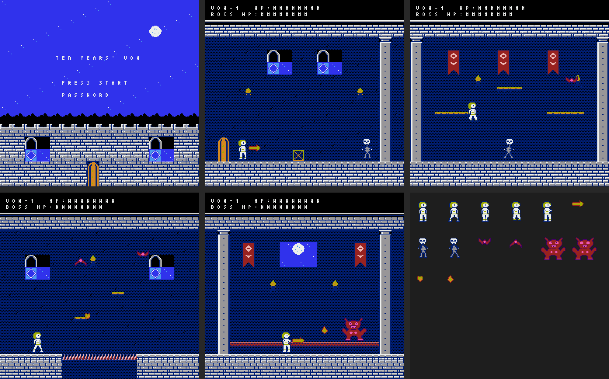

# Chronomicon

**Raise your Pyxel games from the dead, onto real 8-bit cartridges.**

Chronomicon turns a game made with [Pyxel](https://github.com/kitao/pyxel) (a Python retro game engine) into a standard
NES-format ROM (`.nes`, iNES mapper 0 / NROM: 32 KB PRG + 8 KB CHR). The ROM runs in emulators, in the browser player
in this repo, and on a real 1983 8-bit home console through a flash cartridge.

Kiroween 2026 entry, category **Resurrection**: the dead technology is the 8-bit cartridge console and its toolchain.
Chronomicon brings it back with a modern Python engine and a spec-driven, AI-assisted workflow in Kiro.

- **Play it now:** <https://tinycore-hisanori.github.io/chronomicon/> (the browser player with the demo game)
- **Demo video:** REPLACE-WITH-YOUTUBE-URL
- **How Kiro was used:** [docs/KIRO_USAGE.md](docs/KIRO_USAGE.md)



## What it does

```
Pyxel .pyxres + manifest.json + game C code
        │
        ▼  chrono convert   (Python, deterministic)
  CHR tiles · nametables · attribute tables · 4+4 palettes · 8x16 metasprites · ASCII font tiles
        │
        ▼  chrono build     (cc65 / ca65 / ld65 + our runtime)
  build/<name>.nes          (iNES header, NROM, vertical or horizontal mirroring)
        │
        ├─▶ web/ player (tinynes, in the browser)
        └─▶ flash cartridge on real hardware
```

| Stage | What it does |
|---|---|
| Pyxres loader | Reads the `.pyxres` archive (zip + TOML) without running Pyxel: image banks and tilemaps |
| Palette quantizer | Maps Pyxel colors to the console palette through an explicit table in the manifest; at most 4 colors per palette |
| CHR encoder | 8x8 BG tiles and 8x16 sprite tiles to 2bpp, with duplicate and empty tile removal |
| Font mapper | Puts Pyxel's built-in 4x6 font into CHR at ASCII codes, so strings go straight to the screen |
| Nametable / attribute builders | 256x240 screens with a 32 px HUD; one palette per 16x16 block, conflicts are reported, not guessed |
| Metasprite builder | Sprite definitions to hardware sprite lists, plus horizontally flipped variants |
| Emitter | `chr.bin`, `assets.h`, `nametable_N.s`, written atomically |
| ROM builder | Compiles the runtime and the game with cc65, links for NROM, writes the iNES header, checks sizes and vectors |
| Runtime (`runtime/`) | A small Pyxel-like C API: `btn`, `btnp`, `text`, `meta_spr`, `load_screen`, `sfx`, `wait_frame`, password encode / decode |

The game logic is written in C against the runtime API (`runtime/chrono.h`), which mirrors the Pyxel calls the original
game used. Chronomicon is not a general Python to 6502 compiler; it supports a documented "8-bit subset" and fails loudly
outside it (see [.kiro/steering/tech.md](.kiro/steering/tech.md)).

## Quick start

Requirements: Python 3.12, [cc65](https://cc65.github.io/) 2.19 on `PATH`, Node 20+ (only for the ROM tests).

```
python -m venv .venv
.venv\Scripts\python -m pip install -e .[dev]        # Windows (use .venv/bin/python on macOS / Linux)

.venv\Scripts\chrono convert samples/ten_years_vow/manifest.json
.venv\Scripts\chrono build   samples/ten_years_vow/manifest.json      # writes build/ten_years_vow.nes
```

Open `web/index.html` and drop the `.nes` file on it, or open it in any NES emulator.

Tests (unit, property-based with Hypothesis, and ROM boot tests in the headless emulator):

```
.venv\Scripts\python -m pytest
set HYPOTHESIS_PROFILE=ci && .venv\Scripts\python -m pytest      # 200 examples per property
```

## The demo game: TEN YEARS' VOW

Ten years ago a demon took the castle. The princess who escaped trained as a knight, and now she comes back to keep her
vow. Four rooms, one boss, a password system.

- START begins. Left / Right walk, A jumps, B swings the sword.
- SELECT pauses and shows a 6-letter password; on the title screen SELECT opens password entry.
- Password `ASEAAW` goes straight to the boss.

Files: `samples/ten_years_vow/` (`ten_years_vow.pyxres`, `manifest.json`, `main.c`).

## Real hardware

The demo video ends with the ROM running on a real console. The hardware used (designed for this project, not part of
the Kiro-built software):

- **Cartridge:** NROM flash board, 60-pin, two SST39SF010A flash chips in PLCC-32 sockets (PRG and CHR), mirroring jumper.
- **Writer:** an Arduino Mega 2560 shield with a 32-pin socket, plus a small Python script. PRG = `.nes` bytes 16 to 32783,
  CHR = the next 8192 bytes.

Details: [.kiro/steering/hardware.md](.kiro/steering/hardware.md).

## Repository layout

```
.kiro/       steering files and the two specs (asset-converter, rom-builder) Kiro worked from
converter/   asset converter (chrono convert)
builder/     ROM builder (chrono build)
runtime/     C / 6502 runtime linked into every ROM
samples/     demo game and a boot test ROM
tests/       pytest + Hypothesis property tests, ROM harness on the headless emulator
web/         browser player (tinynes) and the demo ROM
docs/        spec seeds, Kiro usage write-up, images
```

## Who made what

- **Kiro** (spec-driven, from the seeds in `docs/`): asset converter, ROM builder, runtime, tests.
- **Claude** (Anthropic): the demo game's pixel art (`samples/ten_years_vow/art/make_tyv_assets.py`) and game code
  (`main.c`), the browser player / emulator `web/nes.js`, the hardware review and the cartridge writer.
- **Tiny Core Inc.**: direction, specs, hardware build, testing on real hardware.

Details and the honest list of what went wrong: [docs/KIRO_USAGE.md](docs/KIRO_USAGE.md).

## Trademarks

This project is not affiliated with or endorsed by any console maker. "NES" appears only as the name of the ROM file
format. Pyxel is used only as the input format.

## License

MIT, see [LICENSE](LICENSE). Third-party material (the Pyxel built-in font data, MIT) is listed in
[THIRD_PARTY_NOTICES.md](THIRD_PARTY_NOTICES.md).
